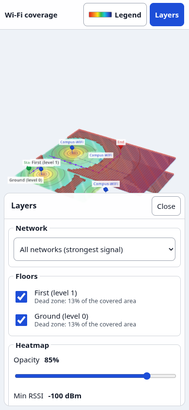
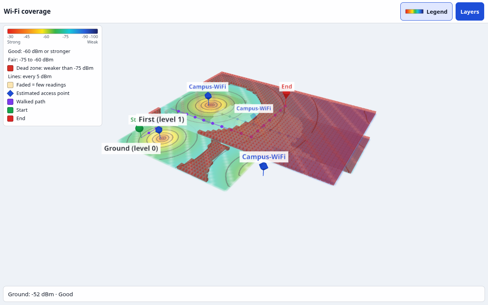
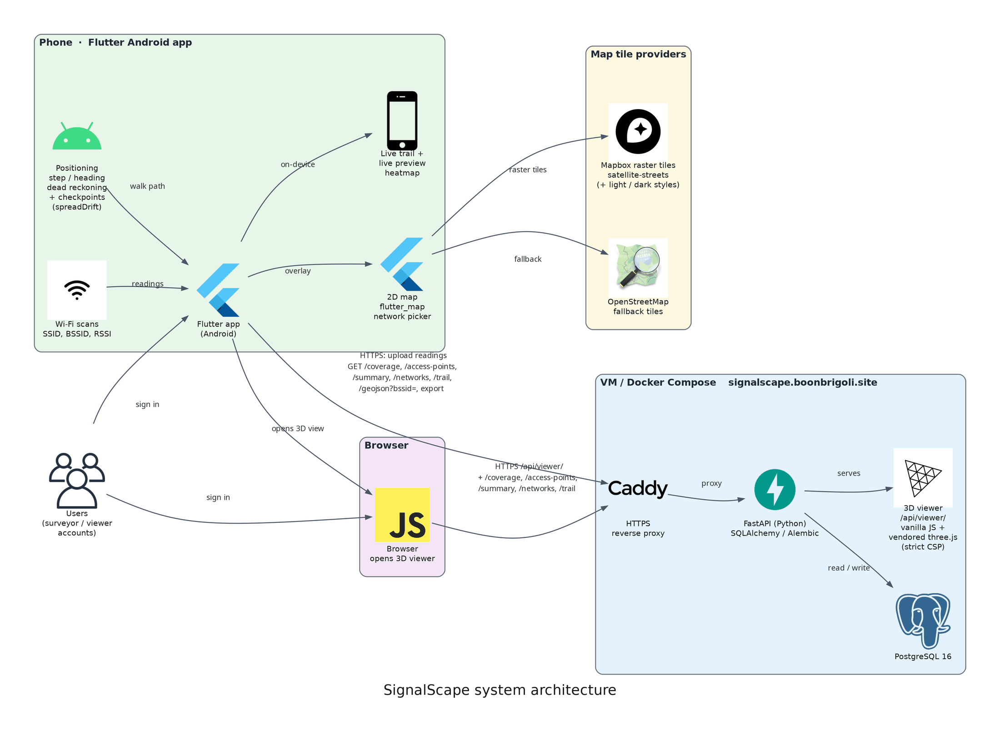
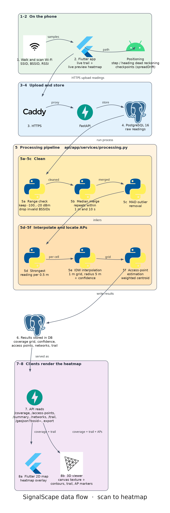
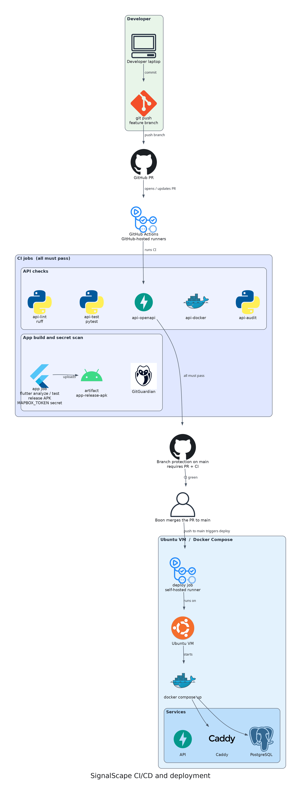

# SignalScape

Map a building's Wi-Fi coverage in 3D with just an Android phone.

SignalScape is the ITSD 85 (Special Topics in Software Development) final project. A surveyor walks a building with the app. The phone records Wi-Fi signal strength while tracking its own position from step counting, gyroscope and compass, and it detects floor changes with the barometer. The API fills the gaps between readings with interpolation math, estimates where the access points are, and serves a 3D coverage map. Good, fair and dead zones show at a glance.

**Target users:** owners and facility managers of small and medium establishments (cafés, boarding houses, dormitories, clinics, small offices, schools) who need to find Wi-Fi dead zones and plan router placement but can't afford a professional site survey. **Pilot site:** our college, CISC, which has several known Wi-Fi dead zones; it will be surveyed for testing and the live demo.

## Features
- Building and floor setup with checkpoints that correct position drift
- Wi-Fi survey capture (RSSI) with indoor positioning and floor detection
- Coverage gap filling (inverse distance weighting or kriging) and access point location estimates
- Interactive 3D coverage view (Three.js)
- Role-based access: Admin and Surveyor (Viewer optional)
- Signal bands: good above -67 dBm, fair from -67 to -80 dBm, dead below -80 dBm

## App preview

The 3D coverage view (smooth heatmap, trail, access-point markers, and the grouped Layers controls). More on using the map: [User guide](docs/USER_GUIDE.md).

<table>
  <tr>
    <td align="center" valign="top">
      
      <br />
      <em>Mobile, Layers sheet open</em>
    </td>
    <td align="center" valign="top">
      
      <br />
      <em>Desktop</em>
    </td>
  </tr>
</table>

## Stack
| Part | Tech |
|---|---|
| Mobile app | Flutter (Android) with Three.js in a WebView |
| API | FastAPI, SQLAlchemy, Alembic, Pydantic, bcrypt, JWT, NumPy/SciPy |
| Database | PostgreSQL |
| Tests | pytest with pytest-cov, `flutter test` |
| Deploy | Docker Compose, Caddy (automatic HTTPS), GitHub Actions with a self-hosted runner |

## Architecture

How the pieces connect, how a scan becomes a heatmap, and how a change gets to the live server. The same images are in the docs linked under each preview.

**System architecture** — the Flutter Android app, Mapbox / OpenStreetMap tiles, Caddy, FastAPI, PostgreSQL and the three.js viewer.



More: [Design](docs/DESIGN.md#architecture-overview) ([SVG](docs/images/architecture/signalscape_system_architecture.svg))

**Data flow** — from a Wi-Fi scan on the phone, through upload and the six processing stages, to the 2D and 3D heatmaps.



More: [Design, processing math](docs/DESIGN.md#5-processing-math) ([SVG](docs/images/architecture/signalscape_data_flow.svg))

**CI/CD and deployment** — laptop to GitHub PR and Actions, then the self-hosted runner and Docker Compose on the Ubuntu VM.



More: [CI/CD guide](docs/CI_CD.md) and [Deployment setup](docs/DEPLOYMENT.md) ([SVG](docs/images/architecture/signalscape_cicd_deployment.svg))

## Repo layout
```
signalscape/
├── api/                  # FastAPI backend
├── app/                  # Flutter Android app
├── docs/                 # Design, CI/CD, deployment and user documentation
├── .github/workflows/    # CI and CD
├── REQUIREMENTS.md       # What to build
├── IMPLEMENTATION.md     # Build order and progress
├── AGENTS.md             # Workflow rules for contributors and agents
└── README.md
```

## Getting started

### Prerequisites
- Docker and Docker Compose
- Python 3.12 (for running the API outside Docker)
- Flutter SDK and an Android device (Wi-Fi scanning doesn't work in the emulator)

### API
```bash
cd api
cp .env.example .env      # fill in the values
docker compose up -d      # starts the API and Postgres
```
- API docs: http://localhost:8000/api/docs
- Health check: http://localhost:8000/api/health

#### First admin
New accounts are Surveyors. Create the first admin from the command line (the password comes from `SIGNALSCAPE_ADMIN_PASSWORD`, or is prompted if unset):
```bash
cd api
SIGNALSCAPE_ADMIN_PASSWORD='choose-a-password' python -m app.cli create-admin --email you@example.com --name "Your Name"
# in Docker: docker compose exec -e SIGNALSCAPE_ADMIN_PASSWORD=... api python -m app.cli create-admin --email ... --name ...
```
Add `--promote` to turn an existing account into an admin. Admins can then manage other users through `/api/users`.

### Mobile app
```bash
cd app
flutter pub get
flutter run               # with an Android phone connected
```
Point the app's API base URL at your running API.

### Tests
```bash
cd api && pytest --cov            # backend coverage must stay at 60% or more
cd app && flutter test
```

## CI/CD
- **CI** (`.github/workflows/ci.yml`) runs on every push and pull request. It covers lint, tests with a Postgres container, the OpenAPI check, the Docker build, a dependency scan, `flutter analyze`, `flutter test` and the APK build. Backend coverage below 60% fails the build. API jobs run only when `api/` or a workflow changes, and the Flutter job only when `app/` or `ci.yml` changes. The secret and dependency scan always runs, and tags and manual runs run everything.
- **CD** (`.github/workflows/cd.yml`) runs after CI succeeds on `main`. It pushes the API image to GitHub Container Registry, then a self-hosted runner pulls the image, restarts Docker Compose (with Caddy), runs migrations, and smoke tests `/api/health` and `/api/docs` through the public HTTPS URL.
- The final release is tagged `v1.0`.

### GitHub secrets (for CD)
Set these in the repo under Settings → Secrets and variables → Actions:

| Secret | Purpose |
|---|---|
| `POSTGRES_PASSWORD` | Database password on the server |
| `JWT_SECRET` | Signing key for API tokens |
| `SITE_ADDRESS` | Public hostname Caddy serves (`signalscape.boonbrigoli.site`) |
| `API_BASE_URL` | Public URL for the smoke test (`https://signalscape.boonbrigoli.site`) |
| `MAPBOX_TOKEN` | Optional. Public Mapbox token baked into the release APK for the 2D map (empty means OpenStreetMap tiles) |

### Self-hosted runner
CD deploys on a runner installed on the server (`runs-on: self-hosted`). The runner user must be able to run Docker. Add it from the GitHub repo: Settings → Actions → Runners → New self-hosted runner, then follow the Linux steps. The runner on the course VM is `signalscape-vm` (labels `self-hosted, Linux, X64, signalscape`).

### Public access
Production runs at https://signalscape.boonbrigoli.site. An A record points that hostname at the VM, and the VM's cloud firewall and `iptables` allow TCP 80 and 443. Caddy serves the hostname from `SITE_ADDRESS`, gets its HTTPS certificate from Let's Encrypt automatically (stored in the `caddy_data` volume), sends `/api/*` to the API, and shows a placeholder page for everything else. Locally `SITE_ADDRESS` defaults to `:80`, plain HTTP.

## Documentation
All in `docs/`:

| Doc | What it covers |
|---|---|
| [DESIGN.md](docs/DESIGN.md) | Database, API, processing maths, offline sync, and the system and data-flow diagrams |
| [LOCAL_DEV.md](docs/LOCAL_DEV.md) | Set up the API, database and app on your machine; run the tests |
| [CI_CD.md](docs/CI_CD.md) | The full flow from a push to the live server, job by job (with the CI/CD diagram) |
| [DEPLOYMENT.md](docs/DEPLOYMENT.md) | The VM, runner, Docker Compose, Caddy and TLS, SSH access, first admin |
| [BRANCHING.md](docs/BRANCHING.md) | Branch names, pull requests, Actions and branch protection |
| [CONFIG_AND_SECRETS.md](docs/CONFIG_AND_SECRETS.md) | Every environment variable and GitHub secret (names only) |
| [RUNBOOK.md](docs/RUNBOOK.md) | Logs, restarts, backups, rollback, key rotation, site-down checklist |
| [API_GUIDE.md](docs/API_GUIDE.md) | Quick start with `curl` examples (full reference at `/api/docs`) |
| [USER_GUIDE.md](docs/USER_GUIDE.md) | Surveyor guide for the app |

## Contributing
Read `AGENTS.md` first. In short, work through `IMPLEMENTATION.md` in order, use one branch per item, add tests with every change, open a pull request with passing CI, and tick the checkbox in the same pull request.

## Privacy
Built to comply with the Data Privacy Act of 2012 (RA 10173). Only account details and building scan data are stored, and secrets never go in the repo. See `REQUIREMENTS.md` for details.

## Author
Boon Jefferson Brigoli (solo project)
