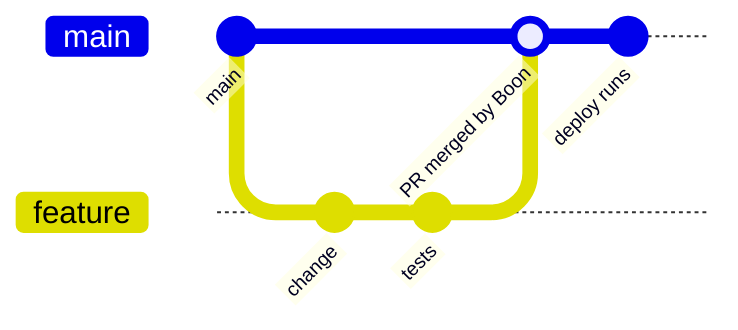

# Branching and GitHub workflow

How work moves through the GitHub repository `Brigoliboon/signalscape`: branch names, pull requests, who merges, what Actions does, and which rules protect `main`. The protection settings were read from the GitHub API on 2026-11-16. Contributor rules in general are in `AGENTS.md`; the pipeline itself is in [CI_CD.md](CI_CD.md).

## Overview



One long-lived branch, `main`. Everything else is a short-lived branch that lives for one pull request.

## Branch names

Branch off the latest `main` and use one branch per task. The prefixes actually used in the repo's 18 pull requests:

| Prefix | Use | Examples from the history |
|---|---|---|
| `feat/` | New feature or milestone item | `feat/m3-auth`, `feat/processing`, `feat/3d-view`, `feat/2d-map`, `feat/heatmap-accuracy` |
| `fix/` | Bug fix | `fix/cd-smoke-test` |
| `docs/` | Documentation only | `docs/design`, `docs/requirements-update`, `docs/devops-and-guides` |
| `ci/` | Workflow changes | `ci/path-filters` |

`AGENTS.md` asks for `feat/<milestone>-<short-name>` (for example `feat/m3-auth`), `fix/...` and `docs/...`. Keep names lower case, with hyphens.

Stacked work: when a branch builds on another unmerged branch, open the PR against that branch and say so in the PR text. PR #18 (`feat/heatmap-accuracy`) did this against `feat/map-satellite-networks`. GitHub moves a stacked PR to `main` automatically only when the base branch is *deleted* after its PR merges, and "delete branch on merge" is off in this repo. So merge the base PR first, then check and change the stacked PR's base before merging it (see the caution below).

## Day-to-day steps

1. `git fetch origin` and `git checkout -b <prefix>/<name> origin/main`.
2. Make the smallest change that completes the task. Add tests in the same change.
3. Run the local checks ([LOCAL_DEV.md](LOCAL_DEV.md)).
4. Commit with a conventional message: `feat:`, `fix:`, `test:`, `docs:`, `ci:`, `chore:` or `refactor:`, short and in the present tense.
5. `git push -u origin <branch>` and open a pull request into `main` (`gh pr create` or the GitHub page). Fill in the template from `.github/pull_request_template.md`:

   ```
   What: <one line>
   Covers: <FR/C/CI/CD ids>, milestone <Mx>
   Tests: <what was added or run>
   Notes: <migrations, env vars, anything a reviewer must know>
   ```

6. Wait for the `CI` check to go green. Fix and push again if it does not (a new push cancels the older CI run on that PR).
7. Boon reviews and merges the PR on GitHub. Contributors and coding agents do not merge their own PRs.
8. The merge to `main` runs CI again and then deploys automatically. Check `https://signalscape.boonbrigoli.site/api/health` afterwards.
9. In the same PR as the work, tick the item in `IMPLEMENTATION.md` and add a dated line to its progress log.

Rules that always apply (from `AGENTS.md`): never push straight to `main`, never commit secrets, never lower the coverage threshold, do not skip tests to get green.

## Commit authorship

Commits in this repo come from two identities:

- `Brigoliboon`: Boon's own GitHub account. It appears on the **merge commits** created when a PR is merged from the GitHub page (`Merge pull request #N from ...`), and on Boon's own commits.
- `devxploit`: the identity for commits written by Boon's coding assistants on his laptop (26 commits at the time of writing). Set it per command so no global config changes:

  ```bash
  git -c user.name=devxploit -c user.email=<commit-email> commit -m "docs: add runbook"
  ```

A few early commits are authored as `Boon Jefferson Brigoli` and one as an assistant account; they are history and do not need to be repeated.

## GitHub Actions overview

Two workflows are defined in `.github/workflows/`:

| Workflow | File | Runs on | Purpose |
|---|---|---|---|
| `CI` | `ci.yml` | every PR, pushes to `main`, `v*` tags, manual | lint, tests, OpenAPI check, Docker build, audit and secret scan, Flutter checks and APK build |
| `CD` | `cd.yml` | CI finished on `main` after a push, or manual | build and push the API image, deploy on the self-hosted runner, smoke test |

Per-job detail is in [CI_CD.md](CI_CD.md). Repository Actions settings (read from the API):

- Actions are enabled, and all actions are allowed (`allowed_actions: all`, no SHA pinning required).
- The default `GITHUB_TOKEN` permission is **read**; each workflow raises only what it needs.
- Workflows cannot approve pull requests (`can_approve_pull_request_reviews: false`).
- Artifact and log retention is 90 days.
- The repository is **public**.

Repository secrets (names only; values are never shown): `API_BASE_URL`, `JWT_SECRET`, `MAPBOX_TOKEN`, `POSTGRES_PASSWORD`, `SITE_ADDRESS`. There are no repository variables. See [CONFIG_AND_SECRETS.md](CONFIG_AND_SECRETS.md).

## Branch protection on `main`

Classic branch protection is **not** used (`GET /branches/main/protection` returns "Branch not protected"). `main` is protected by a **repository ruleset** instead, which is the newer mechanism:

| Setting | Value |
|---|---|
| Name | `protect-main` |
| Enforcement | Active |
| Target | the default branch (`~DEFAULT_BRANCH`, which is `main`) |
| Bypass | nobody (empty bypass list). Not even the repo owner can bypass it. |
| Rule: restrict deletion | on, `main` cannot be deleted |
| Rule: block force pushes | on (`non_fast_forward`) |
| Rule: require a pull request | on. Required approving reviews: **0**. Stale reviews are not dismissed on push, code owner review is not required, last-push approval is not required, review conversations do not have to be resolved. Allowed merge methods: merge, squash and rebase. |
| Rule: require status checks | on. One required check: `CI` (the aggregate job of the CI workflow, from GitHub Actions). "Require branches to be up to date" is **off** (`strict_required_status_checks_policy: false`). |

What this means in practice:

- Nothing reaches `main` except through a PR whose `CI` check passed. Because `CI` is skipped-tolerant (see [CI_CD.md](CI_CD.md)), docs-only and app-only PRs can still merge.
- No review is required, so Boon (or anyone with merge rights) can merge a PR with green CI without a second person. That fits a solo project, but see the recommendations.
- Other repository merge settings: merge commits, squash and rebase are all enabled; "delete branch on merge" is off (so merged branches stay until deleted by hand); auto-merge is off.

### Recommendations (not currently configured)

These are suggestions only; none of them is set today.

- Turn on **Automatically delete head branches** so merged branches do not pile up. There are many merged branches on the remote now.
- Turn on **Require branches to be up to date before merging** if stacked or parallel PRs start to conflict; it costs an extra CI run per merge.
- Consider requiring **1 approving review** once there is more than one maintainer. For a solo project it would block Boon from merging his own PRs, since the ruleset has no bypass list.
- Add the individual jobs (`api-test`, `app`, and so on) as required checks only if the aggregate `CI` job is ever removed. As it stands, `CI` already depends on all of them.
- Keep the stacked PR habit safe: merge the base PR first, then change the stacked PR's base to `main` in the GitHub page (or retarget with `gh pr edit <n> --base main`) before merging it.

### Caution found in this repo's history

On 2026-11-16, PR #18 was stacked on PR #17's branch. #17 was merged into `main` first, and #18 was then merged into the (already merged) `feat/map-satellite-networks` branch instead of `main`, so the changes of #18 did not reach `main` and needed a follow-up PR. Check the base branch shown at the top of a PR before pressing merge.

## Related files

- `.github/pull_request_template.md`: the PR description template.
- `.github/workflows/ci.yml` and `cd.yml`: the pipelines.
- `.gitleaks.toml`: the secret-scan config used by CI.
- `AGENTS.md`: the contributor and agent rules.
