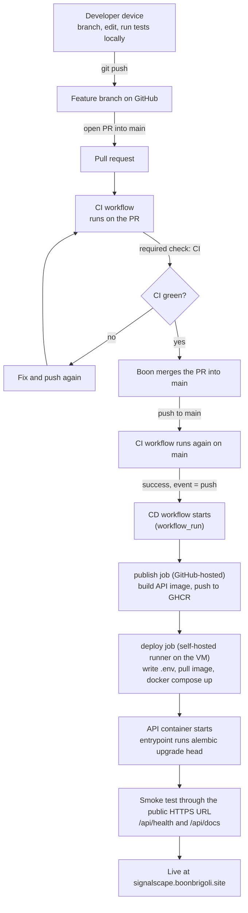
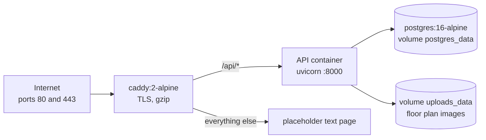

# CI/CD flow

How a change goes from a developer's device to the live server. Everything here is read from `.github/workflows/ci.yml`, `.github/workflows/cd.yml`, `api/docker-compose.yml`, `api/Caddyfile` and `api/entrypoint.sh`, and from the GitHub repository and server settings as checked on 2026-11-16.

Related docs: [DEPLOYMENT.md](DEPLOYMENT.md) (the server and runner setup), [BRANCHING.md](BRANCHING.md) (branches, PRs and protection), [CONFIG_AND_SECRETS.md](CONFIG_AND_SECRETS.md) (every variable and secret), [RUNBOOK.md](RUNBOOK.md) (operations and rollback).

## The whole flow



## 1. On the developer device

1. Branch off `main` (`feat/...`, `fix/...`, `docs/...`, see [BRANCHING.md](BRANCHING.md)).
2. Make the change and add tests. Run the same checks CI runs (commands in [LOCAL_DEV.md](LOCAL_DEV.md)):
   - API: `ruff check .`, `ruff format --check .`, `pytest` (coverage must stay at 60% or more; the pyproject gate is `--cov-fail-under=60`).
   - App: `flutter analyze`, `dart format --output=none --set-exit-if-changed .`, `flutter test`.
3. Commit (conventional commit messages, see `AGENTS.md`) and `git push -u origin <branch>`.
4. Open a pull request into `main`. The PR template (`.github/pull_request_template.md`) asks for What, Covers, Tests and Notes.

## 2. CI (`.github/workflows/ci.yml`, workflow name `CI`)

**Triggers:** `push` to `main`, `push` of tags matching `v*`, every `pull_request`, and manual `workflow_dispatch`.

**Concurrency:** group `ci-<ref>`. A new push to the same branch or PR cancels the older run, except on `main`, where runs are never cancelled.

**Permissions:** `contents: read` for the workflow. Only the `app` job raises it to `contents: write` (to attach the APK to a release) and `changes` adds `pull-requests: read`.

### Jobs

| Job (check name) | Runs when | What it does |
|---|---|---|
| `changes` | always | `dorny/paths-filter@v3` decides which parts changed. Output `api` is true when `api/**` or `.github/workflows/**` changed. Output `app` is true when `app/**` or `.github/workflows/ci.yml` changed. On a tag push or a manual run both are forced to true. |
| `api-lint` | `api` changed | Python 3.12, `pip install -r requirements-dev.txt`, `ruff check .`, then `ruff format --check .`, in `api/`. |
| `api-test` | `api` changed | Starts a `postgres:16-alpine` service (database `signalscape_test`), sets `DATABASE_URL` and `JWT_SECRET=ci-test-secret`, runs `pytest` with coverage (fails under 60%), uploads `api/coverage.xml` as artifact `api-coverage` (even when tests fail). |
| `api-openapi` | `api` changed | Same Postgres service. Runs `alembic upgrade head`, starts `uvicorn` on 127.0.0.1:8000, waits for `/api/health`, then checks `/api/docs` loads and that `/api/openapi.json` contains the `/api/health` path. |
| `api-docker` | `api` changed | `docker build -t signalscape-api:ci ./api`, then `docker compose -f api/docker-compose.yml config` to validate the Compose file. |
| `api-audit` | always | Full-history checkout, `pip-audit -r api/requirements.txt` (dependency vulnerabilities), then the Gitleaks container (`ghcr.io/gitleaks/gitleaks:latest detect`, config `.gitleaks.toml`, output redacted) to scan for secrets. |
| `app` | `app` changed | Java 17 (Temurin), Flutter 3.41.6 (stable channel), then in `app/`: `flutter pub get`, `flutter analyze`, `dart format --output=none --set-exit-if-changed .`, `flutter test`, `flutter build apk --release --dart-define=MAPBOX_TOKEN=$MAPBOX_TOKEN` (secret `MAPBOX_TOKEN`; empty means OpenStreetMap tiles in the app). It then uploads the APK as artifact **`app-release-apk`** (`app/build/app/outputs/flutter-apk/app-release.apk`). The job skips every Flutter step if `app/pubspec.yaml` does not exist. |
| `CI` (job id `ci-success`) | always, even after failures | The single required check. It needs all the jobs above. `changes` and `api-audit` must be `success`. Each of `api-lint`, `api-test`, `api-openapi`, `api-docker` and `app` must be `success` or `skipped`. |

Notes:

- A **docs-only PR** skips every path-filtered job. Only `changes`, `api-audit` and `CI` run, and `CI` passes.
- Skipped jobs count as passing, so a PR that touches only `app/` does not run the API jobs, and the other way round. Changing a workflow file runs the API jobs and, if it is `ci.yml`, the app job too.
- **Artifact retention:** `app-release-apk` is kept for 90 days. The workflow sets no `retention-days`, so it uses the repository default, which is 90 days (also the maximum allowed). The GitHub API shows an expiry about 90 days after each run. Download it from the run's page under Actions, in the Artifacts section.
- **Third-party check:** the PR list also shows a `GitGuardian Security Checks` status. It comes from the GitGuardian GitHub app, not from a workflow in this repo. It is not in the required checks.

### Releases (tags)

Pushing a tag that starts with `v` (for example `v1.0`, the planned release tag) runs CI with every job forced on. The `app` job then also runs the step `softprops/action-gh-release@v2`, which attaches `app-release.apk` to a GitHub Release for that tag. No tag or release exists yet (`git tag` and `gh release list` are empty on 2026-11-16).

A tag push runs CI only. It does not deploy, because CD only reacts to runs on the `main` branch triggered by a push.

The release APK is signed with the Android **debug** key (`signingConfig = signingConfigs.getByName("debug")` in `app/android/app/build.gradle.kts`), so it installs on phones for testing but is not a Play Store build.

## 3. Merge

The `protect-main` ruleset requires a pull request and a passing `CI` check before anything reaches `main`, and blocks force pushes and branch deletion. Details in [BRANCHING.md](BRANCHING.md). Boon merges the PRs. Merge, squash and rebase are all allowed by the ruleset; the repository history shows merge commits (`Merge pull request #N ...`).

## 4. CD (`.github/workflows/cd.yml`, workflow name `CD`)

**Triggers:** `workflow_run` of `CI` when it completes on branch `main`, and manual `workflow_dispatch`.

**Concurrency:** group `cd-main`, never cancelling. Deploys queue one after another.

**Permissions:** `contents: read`, `packages: write` (to push to GHCR), `actions: write`.

Both jobs run only for a manual dispatch, or when the CI run concluded `success` and was a `push` (so PR runs of CI never deploy). The commit used is the CI run's `head_sha` (or `github.sha` for a manual dispatch).

### `publish` (GitHub-hosted `ubuntu-latest`)

1. Check out the commit.
2. Log in to `ghcr.io` with the built-in `GITHUB_TOKEN`.
3. Build `./api` with Docker Buildx (layer cache in the GitHub Actions cache) and push `ghcr.io/brigoliboon/signalscape/api` with two tags: `latest` and the full commit SHA.

### `deploy` (`runs-on: self-hosted`, 20 minute timeout)

Runs on the runner `signalscape-vm` (labels `self-hosted, Linux, X64, signalscape`) that is installed on the VM itself, so it talks to the local Docker daemon and no SSH is involved. See [DEPLOYMENT.md](DEPLOYMENT.md).

1. Check out the commit into the runner's work folder.
2. Log in to `ghcr.io`.
3. **Write production env:** create `api/.env` in the workspace with `umask 077` (file mode 600). It contains `POSTGRES_USER=signalscape`, `POSTGRES_PASSWORD`, `POSTGRES_DB=signalscape`, `JWT_SECRET`, `SITE_ADDRESS` and `API_IMAGE=ghcr.io/<repo>/api:<commit sha>`. The password, JWT secret and site address come from GitHub secrets. The file is rewritten on every deploy.
4. **Pull image and restart stack,** in `api/`:
   - `docker compose --profile prod pull`
   - `docker compose --profile prod up -d`

   The `prod` profile adds the Caddy service. Compose recreates only services whose image or config changed. Named volumes (`postgres_data`, `uploads_data`, `caddy_data`, `caddy_config`) survive.
5. **Migrations:** there is no separate migration step. The API image's entrypoint (`api/entrypoint.sh`) runs `alembic upgrade head` and then starts `uvicorn` on port 8000, so every container start applies pending migrations before the API serves traffic.
6. **Smoke test** (needs secret `API_BASE_URL`; fails if unset). It calls `$API_BASE_URL/api/health` up to 12 times, 5 seconds apart (a loop, because the VM's Ubuntu 20.04 `curl` has no `--retry-all-errors`), then requests `$API_BASE_URL/api/docs`. Both go through the public HTTPS URL, so DNS, Caddy and the certificate are exercised too. The job fails after 12 failed health checks.

### What runs on the server after a deploy



The API container publishes port 8000 only on `127.0.0.1` of the VM; the public reaches it only through Caddy. The API and database containers have `restart: unless-stopped`, and so does Caddy. The API container has a healthcheck against `/api/health`, and Caddy waits for it to be healthy.

## 5. Rollback

There is no automated rollback. Options, from simplest:

- **Revert in Git:** revert the bad PR with a new PR into `main`. Merging it runs the whole flow again. Slow, but leaves a clean history.
- **Redeploy an older image on the VM:** every deploy pushes an image tagged with its commit SHA. Set `API_IMAGE` in the server's `api/.env` to the older tag and run `docker compose --profile prod up -d`. Steps are in [RUNBOOK.md](RUNBOOK.md).
- **Re-run the CD workflow** for an earlier commit from the Actions tab (it can be started manually through `workflow_dispatch`, which uses the commit of the ref you choose).

Database caveat: migrations only go forward when the container starts. An older image does not undo a migration. Additive migrations (a new nullable column, for example) are safe with an older image. A destructive migration needs a restore from a dump; the repository has no automatic backup (see [RUNBOOK.md](RUNBOOK.md)).

## 6. Checking a deploy by hand

```bash
curl -fsS https://signalscape.boonbrigoli.site/api/health   # {"status":"ok"}
```

Then open `https://signalscape.boonbrigoli.site/api/docs`. On the server, `docker compose --profile prod ps` in the runner's `api` folder shows the three containers (see [DEPLOYMENT.md](DEPLOYMENT.md) for the path).

## Not verified

- The `GitGuardian Security Checks` behaviour is taken from the PR checks list, not from any repo file.
- Whether the `ghcr.io/brigoliboon/signalscape/api` package is public or private could not be checked (the token lacks `read:packages`). The deploy job logs in with `GITHUB_TOKEN`, so it works either way.
