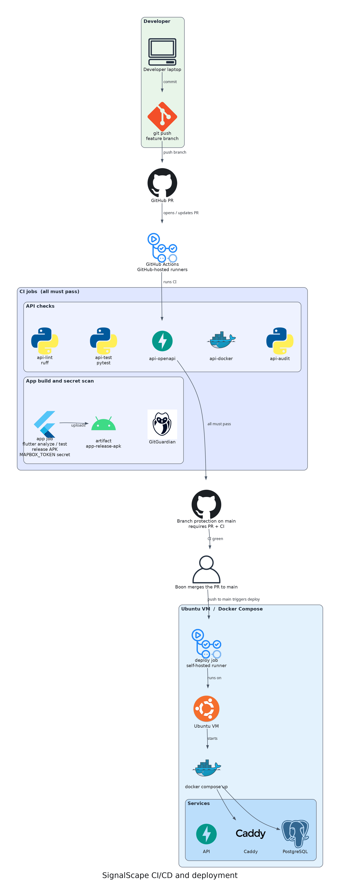
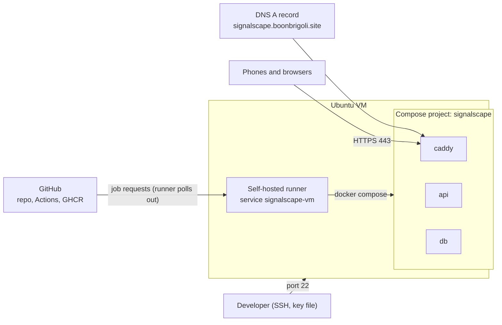

# Deployment setup and server connection

What the production server looks like, how GitHub deploys to it, and how to connect to it. Facts were checked on 2026-11-16 with read-only commands on the server, the GitHub API, `dig` and `curl`, plus the files in this repo. Anything that could not be checked is listed at the end under **Not verified**.

No secret values, key contents or IP addresses are written here. Placeholders look like `<this>`.

Related: [CI_CD.md](CI_CD.md) (what the pipeline does), [CONFIG_AND_SECRETS.md](CONFIG_AND_SECRETS.md) (variable names), [RUNBOOK.md](RUNBOOK.md) (day-to-day operations).

## Overview

How a merge on `main` reaches Docker Compose on the VM (full pipeline, including the CI jobs: [CI_CD.md](CI_CD.md)):



[SVG](images/architecture/signalscape_cicd_deployment.svg)



The runner connects **out** to GitHub, so the server does not need an inbound port for deploys. Deploys never use SSH. SSH is only for people who need to look at or repair the server.

## The server

| Item | Value (checked) |
|---|---|
| Public hostname | `signalscape.boonbrigoli.site` |
| OS | Ubuntu 20.04.6 LTS, x86_64 |
| Docker | Docker Engine 28.1.1, Docker Compose v2.35.1 |
| Login user used by the runner and for admin work | `ubuntu` (member of the `docker` group) |
| Disk | 45 GB root disk, about 32% used when checked |
| Listening ports | 22 (SSH), 80 and 443 (Caddy). The API listens on 8000 but only on `127.0.0.1`. |
| Shared machine | Other, unrelated projects also run on this VM. Everything for SignalScape is in the Docker project `signalscape` (containers `signalscape-api-1`, `signalscape-db-1`, `signalscape-caddy-1`) and the runner folder below. Do not touch anything else. |

### DNS

An **A record** for `signalscape.boonbrigoli.site` points at the VM's public IPv4 address (confirmed with `dig +short`). The domain's DNS is managed at the registrar (the repo history says GoDaddy). To move the site to another server, change that A record.

### Firewall

The repo README says the cloud provider's firewall (security list) and the VM's `iptables` allow TCP 80 and 443. From outside, port 443 answers over HTTPS (`curl -I https://signalscape.boonbrigoli.site/` returns `HTTP/2 200`, `server: Caddy`), and port 22 accepts SSH, so those rules work. The rule listings themselves were not read.

## Files and containers on the VM

The deploy job runs inside the runner's work folder, so that folder is the Compose project directory:

```
/home/ubuntu/actions-runner-signalscape/          the runner itself
/home/ubuntu/actions-runner-signalscape/_work/signalscape/signalscape/    checkout of the repo (updated by every deploy)
/home/ubuntu/actions-runner-signalscape/_work/signalscape/signalscape/api/
    docker-compose.yml     the stack
    Caddyfile              Caddy config, mounted read-only into the caddy container
    .env                   written by the deploy job on every run (mode 600, owner ubuntu)
```

Compose labels on the running containers confirm this directory as the project working directory.

Containers (all `restart: unless-stopped`):

| Container | Image | Notes |
|---|---|---|
| `signalscape-api-1` | `ghcr.io/brigoliboon/signalscape/api:<commit sha>` | Port 8000 on `127.0.0.1` only. Healthcheck calls `/api/health`. Runs `alembic upgrade head` on start. |
| `signalscape-db-1` | `postgres:16-alpine` | Not published to the host. Only the API reaches it, over the Compose network. |
| `signalscape-caddy-1` | `caddy:2-alpine` | Publishes 80/tcp, 443/tcp and 443/udp. Started only with `--profile prod`. |

Docker volumes (names are `<project>_<volume>`):

| Volume | Holds |
|---|---|
| `signalscape_postgres_data` | The PostgreSQL data directory. **All survey data lives here.** |
| `signalscape_uploads_data` | Floor plan images (mounted at `/data/uploads` in the API container) |
| `signalscape_caddy_data` | Caddy's TLS certificates and ACME account |
| `signalscape_caddy_config` | Caddy's autosaved config |

### Environment and secrets on the server

The server's `api/.env` is generated by the deploy job from GitHub Actions secrets. It holds these variable **names**, and nothing else:

`POSTGRES_USER`, `POSTGRES_PASSWORD`, `POSTGRES_DB`, `JWT_SECRET`, `SITE_ADDRESS`, `API_IMAGE`

Docker Compose reads that file for substitution in `docker-compose.yml`. The file is owner-only (mode 600). Never print or commit it. What each name means is in [CONFIG_AND_SECRETS.md](CONFIG_AND_SECRETS.md). Because the file is rewritten on every deploy, edit the GitHub secrets (not the file on the server) to make a lasting change.

## Caddy and TLS

`api/Caddyfile`:

- The site address is `{$SITE_ADDRESS::80}`. In production `SITE_ADDRESS` is the hostname, so Caddy serves it over HTTPS and gets a certificate from Let's Encrypt automatically (the Caddy logs show ACME renewal checks for `signalscape.boonbrigoli.site`). Locally it defaults to `:80`, plain HTTP.
- `encode gzip` for responses.
- `/api/*` is proxied to `api:8000`.
- Everything else returns the text `SignalScape dashboard coming soon`.

Certificates live in the `signalscape_caddy_data` volume, so they survive redeploys. Ports 80 and 443 must stay reachable from the internet for issuance and renewal. Do not delete that volume casually: Let's Encrypt limits how many certificates it will issue for a hostname each week.

## Self-hosted GitHub Actions runner

| Item | Value (checked) |
|---|---|
| Runner name | `signalscape-vm` |
| Labels | `self-hosted`, `Linux`, `X64`, `signalscape` |
| Status in GitHub | online (GitHub API, runner version 2.338.2) |
| Install folder | `/home/ubuntu/actions-runner-signalscape` |
| systemd unit | `actions.runner.Brigoliboon-signalscape.signalscape-vm.service`, enabled, running as user `ubuntu` |
| Registered to | the repository `Brigoliboon/signalscape` |

### Install and register (standard GitHub steps)

On the VM, as `ubuntu`:

1. In GitHub, open the repo, Settings, Actions, Runners, New self-hosted runner, choose Linux x64. GitHub shows the download commands and a short-lived registration token. Download and unpack into `/home/ubuntu/actions-runner-signalscape`.
2. Register it:

   ```bash
   ./config.sh --url https://github.com/Brigoliboon/signalscape \
     --token <REGISTRATION_TOKEN_FROM_GITHUB> \
     --name signalscape-vm --labels signalscape
   ```

   (`self-hosted`, `Linux` and `X64` are added automatically. The registration token expires after about an hour and is only needed here.)
3. Install it as a service so it survives reboots:

   ```bash
   sudo ./svc.sh install ubuntu
   sudo ./svc.sh start
   sudo ./svc.sh status
   ```

4. Make sure `ubuntu` can run Docker without sudo (`groups` should list `docker`; if not, `sudo usermod -aG docker ubuntu` and restart the service).

Check it with `systemctl status actions.runner.Brigoliboon-signalscape.signalscape-vm.service` on the VM, or in GitHub under Settings, Actions, Runners (it should say Online).

If the runner is offline, deploy jobs wait in the queue until it comes back (the `deploy` job has a 20 minute timeout once it starts). To restart it: `sudo systemctl restart actions.runner.Brigoliboon-signalscape.signalscape-vm.service`.

## SSH access

SSH is by key file, not password. Keep the private key outside the repo (`*.pem` is git-ignored, but keep keys elsewhere anyway) with mode 600.

```bash
chmod 600 <path/to/private-key-file>
ssh -i <path/to/private-key-file> ubuntu@signalscape.boonbrigoli.site
```

This works with the hostname as well as the IP (checked). The first connection asks you to confirm the host key.

To give another person or device access, add their **public** key to `/home/ubuntu/.ssh/authorized_keys` on the VM. To remove access, delete that line. See [RUNBOOK.md](RUNBOOK.md) for key rotation.

Never put a private key, a token or a `.env` file in the repo, in an issue, or in chat.

## First-time setup of a new server (summary)

1. Create an Ubuntu VM, open ports 22, 80 and 443 in the cloud firewall.
2. Install Docker Engine and the Compose plugin; add the runner user to the `docker` group.
3. Point the DNS A record at the VM.
4. Install and register the runner as above.
5. Set the GitHub secrets listed in [CONFIG_AND_SECRETS.md](CONFIG_AND_SECRETS.md) (`POSTGRES_PASSWORD`, `JWT_SECRET`, `SITE_ADDRESS`, `API_BASE_URL`; `MAPBOX_TOKEN` is for the app build).
6. Run the **CD** workflow from the Actions tab (Run workflow on `main`), or merge any PR. The deploy job creates `.env`, pulls the image, starts the stack, and Caddy requests the certificate.
7. Create the first admin (below).

## Deploying manually

Normal deploys are automatic after a merge to `main`. To deploy again without a code change, open Actions, choose **CD**, and use **Run workflow** on `main`. (It builds and pushes the image first, then deploys.)

If GitHub Actions is unavailable, you can do what the deploy job does by hand on the VM, from `/home/ubuntu/actions-runner-signalscape/_work/signalscape/signalscape/api`:

```bash
# the existing .env already points API_IMAGE at the running version;
# change that one line to the image tag you want (a full commit SHA or latest)
docker login ghcr.io            # needs a GitHub token that can read packages
docker compose --profile prod pull
docker compose --profile prod up -d
curl -fsS https://signalscape.boonbrigoli.site/api/health
```

Only edit the `API_IMAGE` line. Do not echo or paste the rest of the file. The next automatic deploy overwrites the file. This manual path was not run as part of writing this document.

## Creating the first admin (CLI)

New accounts registered through the API or the app are Surveyors. Admins are created from the command line (`api/app/cli.py`). The password comes from the environment variable `SIGNALSCAPE_ADMIN_PASSWORD`, or is prompted for (twice) if the variable is not set.

On the VM, in the same `api` folder as above, use the prompt so the password never lands in shell history:

```bash
docker compose --profile prod exec api python -m app.cli create-admin \
  --email you@example.com --name "Your Name"
```

To turn an account that already exists into an admin (its password stays unchanged), add `--promote`. The password must be at least 8 characters. Locally, with the API outside Docker, run `python -m app.cli create-admin ...` from `api/` (see [LOCAL_DEV.md](LOCAL_DEV.md)).

## Not verified

- The exact commands originally used to install the runner were not recorded. The steps above are the standard GitHub procedure and match the result found on the VM (folder, service name, labels, user).
- The firewall and `iptables` rules themselves, and the DNS provider's panel, were not read. The behaviour (ports 22, 80 and 443 reachable, A record present) was confirmed from outside and from the VM's listening sockets.
- The manual deploy path and `create-admin` on the production server were not executed while writing this document.
