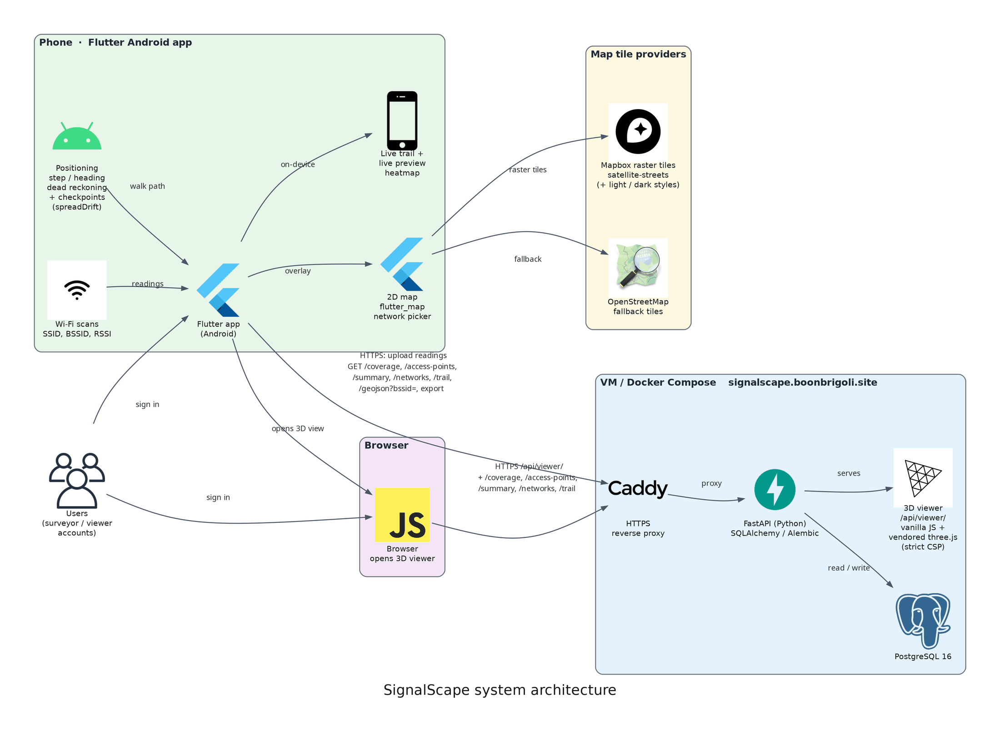
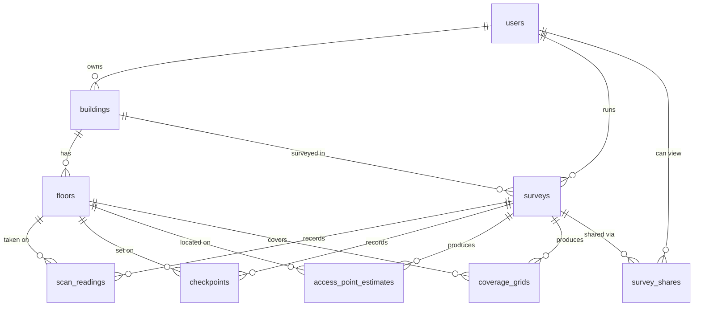

# SignalScape: Design (week 2)

Draft for review. Covers the database schema, the REST API, access control and the processing math. Requirement IDs (FR-x, C-x) refer to `REQUIREMENTS.md`.

## Architecture overview

How the phone, the map tiles, the API and the 3D viewer fit together. A walk-through of the same path, from a Wi-Fi scan to the heatmap, is under [Processing math](#5-processing-math).



[SVG](images/architecture/signalscape_system_architecture.svg)

## 1. Conventions

- **IDs:** UUID v4 for every table except `scan_readings` (bigint, for volume).
- **Times:** `timestamptz`, stored in UTC, sent as ISO 8601.
- **Positions:** WGS84 latitude/longitude (EPSG:4326) are the source of truth. The phone takes a GPS fix at survey start (accuracy 10 m or better, ideally at an entrance or window) as the survey origin, then adds dead-reckoning offsets in meters and converts them to lat/lng. No building outline or manual geo-anchoring is needed. For math, the API projects lat/lng to local meters around the survey origin (equirectangular, accurate to centimeters at building scale) and converts results back.
- **Deletes:** hard deletes with `ON DELETE CASCADE` from parent to child, so deleting an account or survey removes all its data (FR-20, RA 10173).
- **Timestamps:** every table has `created_at`; editable tables also have `updated_at`.

## 2. Database schema (PostgreSQL 16)



### users
| Column | Type | Notes |
|---|---|---|
| id | uuid PK | |
| email | text, unique (case-insensitive) | login |
| name | text | |
| password_hash | text | bcrypt (FR-3a) |
| role | enum `admin`, `surveyor`, `viewer` | default `surveyor` (FR-2) |
| is_active | boolean | default true; admins can deactivate |
| consented_at | timestamptz, null | set on the consent screen (FR-22); surveys need it |
| good_threshold_dbm | smallint | default -67 (FR-15) |
| dead_threshold_dbm | smallint | default -80; check `dead < good` |
| created_at, updated_at | timestamptz | |

### buildings
| Column | Type | Notes |
|---|---|---|
| id | uuid PK | |
| owner_id | uuid FK users, cascade | creator |
| name | text | unique per owner |
| address | text, null | |
| description | text, null | |
| created_at, updated_at | timestamptz | |

### floors
| Column | Type | Notes |
|---|---|---|
| id | uuid PK | |
| building_id | uuid FK buildings, cascade | |
| level | smallint | 0 = ground, negative = basement; unique per building |
| label | text | e.g. "2F" |
| width_m, length_m | numeric(6,2), null | optional approximate size (FR-5), used only to size the 3D floor plane |
| height_m | numeric(4,2) | default 3.0; used to stack floors in 3D |
| plan_image_path | text, null | uploaded floor plan, stored in a Docker volume |
| created_at, updated_at | timestamptz | |

### surveys
| Column | Type | Notes |
|---|---|---|
| id | uuid PK | |
| building_id | uuid FK buildings, cascade | |
| surveyor_id | uuid FK users, cascade | |
| status | enum `active`, `paused`, `completed`, `processed` | FR-6 |
| started_at | timestamptz | |
| ended_at | timestamptz, null | |
| device_model | text, null | for the paper's test notes |
| has_barometer | boolean | false means manual floor selection |
| origin_lat, origin_lng | double precision | GPS fix at survey start |
| origin_accuracy_m | real | reported GPS accuracy of that fix |
| step_length_m | numeric(3,2) | default 0.7 |
| notes | text, null | |
| processed_at | timestamptz, null | last processing run |
| created_at, updated_at | timestamptz | |

### scan_readings (FR-7 to FR-9, FR-12)
| Column | Type | Notes |
|---|---|---|
| id | bigint identity PK | |
| survey_id | uuid FK surveys, cascade | |
| floor_id | uuid FK floors, cascade | |
| client_id | uuid | generated on the phone; unique per survey, so offline re-uploads are idempotent (FR-11) |
| lat, lng | double precision | estimated position |
| accuracy_m | real, null | estimated position error |
| bssid | macaddr | |
| ssid | text | empty string for hidden networks |
| rssi_dbm | smallint | check -120 to 0 |
| frequency_mhz | integer | band derived: under 3000 = 2.4 GHz, else 5 GHz |
| scanned_at | timestamptz | |

Indexes: `(survey_id, floor_id)`, `(survey_id, bssid)`, unique `(survey_id, client_id)`.

### checkpoints (FR-10)
| Column | Type | Notes |
|---|---|---|
| id | uuid PK | |
| survey_id | uuid FK surveys, cascade | |
| floor_id | uuid FK floors, cascade | |
| client_id | uuid | unique per survey |
| lat, lng | double precision | true position (tapped by the surveyor or a good GPS fix) |
| estimated_lat, estimated_lng | double precision | dead-reckoning position at that moment, so drift is measurable |
| source | enum `tap`, `gps` | |
| recorded_at | timestamptz | |

### access_point_estimates (FR-14, FR-23 to FR-25)
| Column | Type | Notes |
|---|---|---|
| id | uuid PK | |
| survey_id | uuid FK surveys, cascade | |
| floor_id | uuid FK floors, cascade | floor with the strongest readings |
| bssid | macaddr | unique per survey |
| ssid | text | |
| frequency_mhz | integer | |
| lat, lng | double precision | estimated position (always stored; the API returns them as null when the position is not determined) |
| method | text | `path_loss_lsq` (v1.1), or `weighted_centroid` with fewer than 3 readings and on v1.0 results |
| reading_count | integer | |
| max_rssi_dbm | smallint | |
| confidence | real, null | 0 to 1 placement confidence (v1.1; null on older rows) |
| low_confidence | boolean, null | true below 5 readings or 3 m of spread, or when the fit failed or was clamped (FR-24) |
| spread_m | real, null | 2 x the RMS distance of the readings from their mean |
| computed_at | timestamptz | |

### coverage_grids (FR-13, FR-15, FR-19)
| Column | Type | Notes |
|---|---|---|
| id | uuid PK | |
| survey_id | uuid FK surveys, cascade | |
| floor_id | uuid FK floors, cascade | |
| bssid | macaddr, null | null = strongest signal of any network |
| method | text | e.g. `idw` |
| cell_size_m | real | default 1.0 |
| origin_lat, origin_lng | double precision | south-west corner of the grid |
| cols, rows | smallint | |
| values | jsonb | row-major array of dBm, `null` where there's no data |
| confidence | jsonb, null | same layout as `values`, 0 to 1 (see Coverage confidence); `null` on grids stored before migration 0006, which readers treat as 1 until the survey is processed again |
| good_pct, fair_pct, dead_pct | real | share of covered cells per level |
| good_threshold_dbm, dead_threshold_dbm | smallint | thresholds the percentages and cell levels were computed with (the surveyor's at processing time) |
| raw_reading_count, cleaned_reading_count | integer | readings stored vs. kept after cleaning, for the summary |
| computed_at | timestamptz | |

Unique `(survey_id, floor_id, bssid) NULLS NOT DISTINCT`. Grids are cached results and are rebuilt by `POST /process`.

### survey_shares (Viewer role, FR-2)
| Column | Type | Notes |
|---|---|---|
| survey_id | uuid FK surveys, cascade | PK part |
| user_id | uuid FK users, cascade | PK part; the viewer |
| created_at | timestamptz | |

## 3. Access control (FR-3)

Enforced in the API through a dependency on every route, not in the app.

| Action | Admin | Surveyor | Viewer |
|---|---|---|---|
| Manage users | all | no | no |
| Buildings and floors | all | own | no |
| Create a survey, upload readings | yes | own buildings, after consent | no |
| Read survey, coverage, export | all | own | shared with them |
| Delete a survey | all | own | no |
| Own profile, settings, delete account | yes | yes | yes |

"Own" means `buildings.owner_id` or `surveys.surveyor_id` matches the token's user. Requests for something the user can't see return **404**, not 403, so IDs can't be probed.

## 4. REST API

Base path `/api`. JSON in and out. Auth is `Authorization: Bearer <JWT>` (HS256, 24-hour expiry, claims `sub` = user ID and `role`). OpenAPI is generated by FastAPI at `/api/docs` (C-10).

**List endpoints** (FR-3b) all take `page` (default 1), `page_size` (default 20, max 100), `sort` (field name, prefix `-` for descending) plus the filters below, and return:

```json
{ "items": [], "total": 0, "page": 1, "page_size": 20 }
```

**Errors:** `401` no or bad token, `404` not found or not visible, `409` conflict (duplicate email, floor level), `422` validation error with FastAPI's `detail` list.

### Auth and profile
| Method | Path | Role | Purpose |
|---|---|---|---|
| POST | `/auth/register` | public | create a Surveyor account |
| POST | `/auth/login` | public | email and password, returns `access_token` |
| GET | `/auth/me` | any | profile and thresholds |
| PATCH | `/auth/me` | any | name, password, thresholds |
| POST | `/auth/me/consent` | any | record privacy consent (FR-22) |
| DELETE | `/auth/me` | any | delete account and all data (FR-20) |

### Users (admin)
| Method | Path | Filters and sort |
|---|---|---|
| GET | `/users` | `role`, `is_active`, `q` (name or email); sort `created_at`, `name`, `email` |
| GET / PATCH / DELETE | `/users/{id}` | PATCH sets `role`, `is_active` |

### Buildings and floors (FR-4, FR-5)
| Method | Path | Notes |
|---|---|---|
| GET | `/buildings` | filters `q`, `owner_id` (admin); sort `name`, `created_at` |
| POST | `/buildings` | |
| GET / PATCH / DELETE | `/buildings/{id}` | GET includes its floors |
| GET | `/buildings/{id}/floors` | sort `level` |
| POST | `/buildings/{id}/floors` | |
| PATCH / DELETE | `/floors/{id}` | |
| PUT | `/floors/{id}/plan` | multipart image upload, PNG or JPEG, max 5 MB |
| GET | `/floors/{id}/plan` | returns the image |

### Surveys (FR-6 to FR-12)
| Method | Path | Notes |
|---|---|---|
| GET | `/surveys` | filters `building_id`, `status`, `surveyor_id` (admin), `from`, `to`; sort `started_at`, `status`. Survey objects include read-only `surveyor_name` (FR-30) |
| POST | `/surveys` | `building_id`, device info; needs consent |
| GET / PATCH / DELETE | `/surveys/{id}` | PATCH changes `status` (active, paused, completed) and notes |
| POST | `/surveys/{id}/readings` | batch of up to 1,000 readings; duplicates by `client_id` are skipped; returns counts inserted and skipped |
| GET | `/surveys/{id}/readings` | filters `floor_id`, `bssid`, `min_rssi`; sort `scanned_at`, `rssi_dbm` |
| POST | `/surveys/{id}/checkpoints` | batch, idempotent by `client_id` |
| GET | `/surveys/{id}/checkpoints` | filter `floor_id` |
| GET | `/surveys/{id}/networks` | distinct SSID/BSSID pairs with reading counts (for the FR-17 filter) |
| POST | `/surveys/{id}/shares` | `{ "email": "..." }` of a Viewer |
| DELETE | `/surveys/{id}/shares/{user_id}` | |

### Processing and results (FR-13 to FR-21)
| Method | Path | Notes |
|---|---|---|
| POST | `/surveys/{id}/process` | `preview=true` runs on synced data without changing status; otherwise builds coverage grids (strongest signal plus each BSSID) and access point estimates; runs synchronously (NFR-1, under 30 s per floor); sets status `processed` |
| GET | `/surveys/{id}/coverage` | `floor_id` (required), `bssid` (optional); returns the grid plus the thresholds used |
| GET | `/surveys/{id}/access-points` | filter `floor_id`, `ssid` |
| GET | `/surveys/{id}/summary` | per floor: area covered, readings, floor height, good/fair/dead percentages (FR-19) |
| GET | `/surveys/{id}/routers` | router coverage mode (FR-27 to FR-29), a separate mode from the strongest-signal heatmap; filter `floor_id`. Backward-compatible `floors` (each router, its footprint, and SSID chains with MST links and gap cells) plus `extended_networks`: each named SSID served by two or more routers, with a `likely_main` estimate, the routers as main or extender (undetermined positions stay in the list and off the chain), MST links, gap cells, and the merged coverage heatmap of that SSID. See "Router coverage mode" in section 5. Computed on request from the stored results; needs a processed survey |
| GET | `/surveys/{id}/trail` | the walk, floor by floor in time order: scan positions (one per scan) merged with checkpoints, plus `start` (the survey origin, on the floor of the first point) and `end` (the last scan or checkpoint). Works before processing. Each floor is thinned to 5000 points. Only scan positions and checkpoints are uploaded, so the line is as fine as the scans |
| GET | `/surveys/{id}/export.csv` | all readings as CSV (FR-21) |
| GET | `/surveys/{id}/geojson` | GeoJSON FeatureCollection; params `floor_level`, `bssid`, `include` (`cells`, `access_points`, `readings`) |

**GeoJSON output:** coverage cells are `Polygon` features (properties `rssi_dbm`, `level` good/fair/dead, `floor_level`, `bssid`); access points and readings are `Point` features (`ssid`, `bssid`, `floor_level`, `rssi_dbm`). Map clients show one layer per `floor_level`. The app's 2D map (FR-16a) uses `flutter_map` with Mapbox raster tiles in three looks the person can pick (Satellite `satellite-streets-v12`, the default; Streets light `light-v11`; Streets dark `dark-v11`; same token from `--dart-define=MAPBOX_TOKEN`, choice kept while the app runs; without a token it falls back to the OpenStreetMap street map and credit and the style picker is disabled with a note, because Esri's World Imagery is not free for app use). It reads `/summary` (floor names, thresholds, and a 409 when the survey is not processed yet), `/geojson` (cells and access points) `/trail` and `/networks`, draws one floor at a time (the smooth heatmap picture described under "Heatmap display" in section 5, access point markers, the walk with start and end), and fits the camera to that floor's data. A network picker works like the 3D view's: all networks (strongest signal) or one network by SSID and BSSID, which re-reads `/geojson?bssid=` so the cells and access points are that network's only. It can start processing for Surveyors and Admins when the survey has no results yet. Three.js uses the same data, projected back to local meters around the survey origin, with height `floor_level × floor height`.

## 5. Processing math

The numbered path from a walk-and-scan on the phone, through upload and the cleaning and interpolation stages, to the 2D and 3D heatmaps:


[SVG](images/architecture/signalscape_data_flow.svg)

**Data cleaning (first step of processing):** drop readings outside -100 to -20 dBm or with a bad BSSID; merge repeat scans of the same BSSID within 1 m and 10 s into one reading using the median RSSI; drop outliers more than 2.5 MAD (median absolute deviation) from their 3 m neighborhood median. Cleaned counts are reported in the summary.

**Coverage (FR-13):** inverse distance weighting per floor. For each grid cell, average the readings within a 5 m radius (`IDW_RADIUS_M`), weighted by `1 / d²`; cells with no reading in range stay `null`. For the strongest-signal grid, take each position's maximum RSSI across networks first. RSSI is averaged in dBm, which is fine for a coverage view. IDW is simple, fast enough for NFR-1, and easy to test; kriging can be compared in the paper.

**Why 5 m, not 10 m:** a first test on a phone gave a heatmap that looked vague. Android allows about 4 Wi-Fi scans per 2 minutes, so readings are far apart, and a 10 m radius painted guessed values over areas nobody walked. At 5 m a reading says something about the few steps around it and nothing about the rest, and a cell with no reading within 5 m stays `null` (no data, not drawn). The radius is the constant `IDW_RADIUS_M` in `processing.py`.

**Coverage confidence:** each cell with data also gets a confidence from 0 to 1, so the maps can fade cells that rest on little evidence:

`confidence = min(1, n / 4) * (1 - d_nearest / radius)`

`n` is the number of cleaned readings within the radius of the cell center and `d_nearest` the distance to the closest one. Four or more readings with one on the cell center give 1; a single reading gives at most 0.25; a lone reading at the edge of the radius gives 0. Values are rounded to two decimals and stored next to `values` (`coverage_grids.confidence`), and a cell with no data has `null`. It is returned as `confidence` by `/coverage` and the preview, and as `confidence` in the properties of the `/geojson` cells. Grids stored before this existed have no confidence and are drawn as if it were 1; `POST /process` fills it in. The 3D page and the app draw a cell's opacity as 30% to 100% of normal by confidence, and the legend says "faded = few readings".

**Levels (FR-15):** a cell is good at or above the user's `good_threshold_dbm` (-67), dead below `dead_threshold_dbm` (-80), and fair in between. The levels still drive the summary percentages, the tap info, the legend text, the red dead-zone blocks in the 3D view and the colour of the trail dots; they no longer colour the heatmap itself (see below).

**Heatmap display (3D page, 2D map, live preview):** display only. The API still sends the plain 1 m grid (`values`, `confidence`, `null` = no data). Each client turns it into one continuous picture, the way Acrylic Wi-Fi Heatmaps looks, in four steps. The maths is plain code with tests in two copies that must stay in step: `api/app/static/viewer/heat.mjs` (3D page, Node tests in `api/tests/js/heat.test.mjs`) and `app/lib/core/heatmap.dart` (app, `app/test/heatmap_test.dart`).

1. **Upsample.** Bilinear, 6 pixels per cell (4 for the live preview), and never more than 2048 pixels on the longest side (512 for the preview), so big floors get a smaller factor. The picture covers the grid plus one blank cell on every side. Empty cells are left out of the blend and the remaining weights are renormalised, so a colour never bleeds into an empty area and a value never drifts towards nothing. Each pixel also gets a `coverage` (the share of its four nearest cell centres that have data, 0 to 1) and a blended `confidence`.
2. **Colour.** Each pixel's dBm goes through one ramp, interpolated linearly in RGB between these stops and clamped outside them. The legend is the same ramp as a gradient bar with ticks at -30, -45, -60, -75, -90 and -100 dBm.

   | dBm | colour |
   |---|---|
   | -30 | red `#e3211c` |
   | -45 | orange `#f7861e` |
   | -57 | yellow `#fbe51a` |
   | -67 | green `#38b54a` |
   | -78 | cyan `#18c8dc` |
   | -90 | blue `#2b5fd9` |
   | -100 | dark blue `#1b2166` |

   Opacity of a pixel = `smoothstep(coverage)` × (0.3 + 0.7 × confidence). The first factor makes the covered area end in a soft, rounded edge about one cell wide (half opaque at the outer edge of the outermost cells); the second keeps the "faded = few readings" cue from the confidence section.
3. **Contour lines.** Marching squares on the upsampled field, one thin dark line every 5 dB (multiples of 5, so -50, -55 ...); the step is a parameter. Lines are only made where the picture is at least half covered and not below the minimum signal, so there are none in the soft edge or in empty areas. A saddle cell is settled by its average.
4. **Controls.** Opacity (10% to 100%, default 85%) multiplies the whole picture and redraws nothing. Minimum RSSI (-100 to -30 dBm, default -100) makes everything weaker than that transparent, contours included. A contour switch turns the lines on or off. The 3D page has them in the Layers sheet; the 2D map has a Display button that opens a bottom sheet.

**Where each client draws it.** *3D page:* a canvas texture on a plane one cell larger than the grid on each side, with linear filtering and mipmaps; the contour lines are stroked onto the canvas. The Content-Security-Policy is unchanged. Tapping a floor reports the nearest grid cell's own value and its level (good, fair, dead) from the thresholds, not an interpolated number; a tap in the blank border finds the nearest cell. *2D map:* the GeoJSON gives one square per cell with data, so the app puts the grid back together from the squares (columns and rows come from the squares' average size, the exact cell size from the whole extent, because corners are rounded to 7 decimals). The picture is made in an isolate (`compute`), encoded as a PNG in plain Dart, and shown by flutter_map's `OverlayImageLayer` at the grid's geographic bounds plus the blank cell. Up to eight pictures are kept by floor, network and settings; changing opacity never redraws. A tap on the map shows the nearest cell's value and level. *Live preview:* the same upsampling and ramp, without contour lines, drawn under the trail and made again only when a new preview grid arrives.

**Access points (FR-14):** weighted centroid of the strongest 10 readings for each BSSID, with linear-power weights `10^(rssi / 10)`, placed on the floor where its readings are strongest. A log-distance path-loss fit can replace it later without changing the API, since `method` is stored.

**Access points, v1.1 (FR-23 to FR-25, replaces the centroid above):** for each BSSID, on the floor of its strongest reading, fit `rssi = P0 - 10 n log10(d)` with `d` the 3D distance (the access point 1 m above the phone) by weighted Levenberg-Marquardt over position, `P0` and `n`. Up to the 200 strongest readings are used, weighted `1 / (1 + (max - rssi) / 10)`. `P0` and `n` have weak priors at -40 dBm and 3.0 and are clamped to -60..-20 dBm and 2..4. The fit starts at the weighted centroid and at 8 points one spread around it, and keeps the best. The point may lie outside the walked area (NFR-5) but at most 25 m from the centroid; a clamped fit is low confidence. On a walk narrower than 1 m (one straight corridor) the point is put back on the walk line, because the side cannot be told. Fewer than 3 readings, or a failed fit, use the centroid (`weighted_centroid`). Confident needs 5 or more readings and a spread (2 x the RMS distance from the mean position) of 3 m or more; otherwise `low_confidence` is set and the marker is still drawn, faded. `confidence` (0 to 1) = min(1, count / 10) x min(1, spread / 6 m) x 1 / (1 + (rms / 8 dB)^2), 0 without a fit. A position is only returned and drawn when at least one reading is in the good/strong band (FR-15: at or above `good_dbm`, default -67 dBm, the strong end of the heatmap ramp that is red at -30 dBm and green at -67 dBm). Until then `position_determined` is false, `lat` and `lng` are null in the API and GeoJSON (the estimate is still stored), the 2D map and 3D viewer draw no marker, and picking the access point shows "Position not determined". Router grouping and chain placement also skip those undetermined estimates.

**Router coverage mode (FR-27 to FR-29, `app/services/routers.py`):** computed on request from the stored per-BSSID grids and access point estimates; nothing new is stored. *Routers:* BSSIDs are one router when their first five bytes match (ignoring the locally administered bit `0x02` of the first byte) and the high nibble of the last byte matches, so `aa:bb:cc:dd:ee:10` to `…:1f` are one radio serving several SSIDs. This is how most access points number their virtual BSSIDs, but it is a heuristic: two members whose determined estimates on the same floor are more than 10 m apart stay separate routers. Estimates without a strong (good-band) reading are not used to place a router or to split one. Routers are numbered by their strongest reading, the same number on every floor. *Footprint:* the cell-by-cell strongest value of the router's per-BSSID grids on that floor (cells share the survey's 1 m lattice); its area counts cells at or above the dead threshold. *Chains and gaps:* routers on one floor that broadcast the same non-hidden SSID are a chain (SSIDs served by the same set of routers are one chain). Its placed routers are joined by a minimum spanning tree of their estimated positions. Each link is sampled every 0.5 m on the chain's combined field (strongest of the members' footprints): its status is `dead` if any part is below the dead threshold, else `weak` if any part is below the good one, else `no_data` if nothing on it was measured, else `covered`. Gap cells are the cells within 3 m of a link whose combined value is below the good threshold (weak) or the dead one (dead); unwalked cells are never called dead. *Extended networks:* a named (non-hidden) SSID served by two or more grouped routers, survey-wide, is an extended network. Router mode opens on that list. One router per network is labelled "Likely main" as an estimate, never as fact: the strongest reading of that network name, ties broken by centrality in the chain (the shortest total MST distance to the other placed routers, taken from the floor with the most placed routers of that network), remaining ties by the lower router number. The others are labelled "Extender". Wi-Fi scans do not say which device is the main router or an extender. Routers whose position is not determined stay in the network's list as "Position not determined" and are left out of the drawn chain. *Display:* a separate screen in the app (opened from the 2D map's app bar) and a Mode switch in the 3D page's Layers sheet. Both open on the extended-network list; picking one shows that network's routers linked as a chain (the MST) and its reach as the merged coverage heatmap of the SSID (not per-router footprints as the default view), with the gap markers along the links. Router colours are blues and purples (router 1 is the primary blue `#1D4ED8`), never the green, amber or red of signal levels, which stay for the heatmap, the gap shading (the M10 zone colours and hatch) and the link colours. Placed routers use the access point marker look: solid when confident, a hollow 40% ring with a "?" when not.

**Drift correction (FR-10):** done on the phone. Between two checkpoints (a tapped position or a GPS fix with accuracy 10 m or better), the app spreads the position error linearly over the readings taken in between before uploading, so the API stores corrected positions. Indoor GPS is often 5 to 30 m off, so only good fixes are used.

## 6. Client app behavior

**Offline-first sync (FR-11, FR-12):**
1. Every reading and checkpoint is written to a local sqflite database first, with a phone-generated `client_id` and `synced = false`.
2. A background sync worker posts unsynced rows in batches of up to 500 and marks them synced when the API confirms.
3. On failure it retries with growing waits (5 s, 10 s, 30 s, capped at 2 min) and also retries as soon as connectivity returns.
4. Duplicate `client_id`s are skipped server-side, so a batch that arrived but lost its reply is safe to resend.
5. The survey screen shows the reading count, how many are waiting to sync, and an online/offline indicator. Ending a survey flushes the queue; if still offline the survey stays "ending" locally and is completed and processed once synced.

**Live visuals during a survey:**
- A trail on the floor plan: a solid line through every step (so it stays drawn between Wi-Fi scans, which Android limits to about four per two minutes), a dot per scan colored by RSSI against the user's thresholds (good, fair, dead), and a marker at the start. The view fits the walk, not the heatmap. Works offline.
- When online, a preview heatmap refreshed about every 60 s by calling `POST /surveys/{id}/process?preview=true` on the readings synced so far. Preview results are not marked final and the status stays `active`. It is drawn with the same smooth ramp as the maps, without contour lines.

**Screen layout (3D page and 2D map).** Both screens keep their controls in a few fixed containers so nothing overlaps on a 360 dp phone. *3D page:* a toolbar on top (title, Legend chip with a mini gradient bar, Layers button); the legend as a panel under it, collapsed by default at 600 px or narrower (`NARROW_MAX_PX` in `levels.mjs`) and remembered per session in `sessionStorage`; one bottom dock that holds the tap-info bar and the Layers sheet (a side panel from 700 px). It uses only CSS classes and the `hidden` attribute, so the strict CSP is unchanged. *2D map:* a top card (floors, network, Display and map style buttons), one column at the bottom (tap info, legend and attribution on one row, layer chips), the legend collapsed on a phone, and the shared `ViewSwitch` (2D map | 3D) in both app bars. `MapStyle` and `MapTiles.withStyle` in `app/lib/core/map_tiles.dart` pick the Mapbox style; `MapStylePreference` keeps the choice while the app runs.

## 6a. v1.1 campus, report and dashboard

**Sites and consolidation (FR-33 to FR-35):** a `sites` row has an owner, a name and an optional `outdoor_area` polygon (`[{lat, lng}, ...]`), plus a `site_buildings` join table (migration 0008). `POST /api/sites/{id}/consolidate` loads the readings of the selected surveys, projects them all around the first survey's origin, and groups a reading under a synthetic outdoor area when its position falls inside the polygon. The existing cleaner, IDW grid and path-loss access point estimator then run on the combined readings, so there is one grid per area and one set of access points; nothing is stored. Outdoors the phone uses good GPS fixes for positions (the **Outdoor survey** toggle in the capture screen); indoors the v1.0 start fix, dead reckoning and checkpoints stay.

**Analysis report (FR-36):** figures are read from stored results (`/report/facts`) and never from the model: reading counts, good/fair/dead percentages, per-floor figures, and access point placement confidence. One configured OpenAI-compatible chat provider writes a Markdown summary and recommendations (`AI_API_KEY`, `AI_BASE_URL`, `AI_MODEL`, `AI_TIMEOUT_S`). The API uses `urllib`, so there is no new library. `?format=md` returns the Markdown file. A missing key or failed call gives a 503 with a clear message; the facts and the plotted layers stay exportable.

**Web dashboard (FR-37, NFR-7):** a static page at `/api/dashboard/` (Caddy redirects the site root there) signs in through `/api/auth/login` and keeps the JWT in `sessionStorage`. The page holds no data, writes all API text with `textContent` under a strict CSP, and inherits the API's role rules: Admin for the DTO site work, Surveyor for their own surveys, Viewer through shares.

The layout follows the order of the task, left to right. **Choose** (data panel): One survey or Campus merge, then site, building and a list of surveys. **Look** (stage): Coverage, Routers or 3D tabs, floor chips, and a canvas map. **Understand** (inspector): Summary, Layers, Routers and Report tabs. The selection lives in the URL fragment (`#survey=...&view=routers`, never the token), so a view can be bookmarked or sent.

Design decisions, and the principle behind each:

| Decision | Principle |
| --- | --- |
| App shell with a top bar, a left list and a main canvas, tabs for views, a segmented control for modes | Jakob's law: it works like tools staff already use |
| Selecting a survey opens it at once; the newest processed survey opens on arrival; the view tab, not an Open button, picks the view | Hick's law and Fitts's law: fewer choices and fewer clicks to the goal |
| Three panels, each with one job; the summary leads with one number, the share of good signal, then the detail | Miller's law and progressive disclosure: chunks, not a wall of controls |
| Filters narrow each other (site, then building, then survey); unprocessed surveys stay visible but disabled, with the reason | Error prevention and recognition over recall |
| Controls for one task sit together (floor chips and zoom above the map; legend on it); the primary action in each panel is the only filled button | Proximity, common region and the von Restorff effect |
| Loading, empty and error states say what is happening and what to do, with Retry; a report can be cancelled; toasts confirm without blocking | Visibility of system status, user control and freedom, and the Doherty threshold |
| Same dark theme and the same Good, Weak and Dead colours as the phone app; level is also named and dead cells are hatched | Consistency, and WCAG 1.4.1: colour is never the only signal |
| System fonts, a 4 px spacing scale, one type scale, tabular numbers for dBm | Aesthetic-usability effect and a consistent rhythm |
| Contrast of 4.5:1 for text and 3:1 for control edges, visible focus, ARIA tabs and radio groups, arrow-key map control, reduced-motion support, a skip link | WCAG 2.2 AA and operability from the keyboard |

The map is a canvas in local metres, so cells are true squares and the scale bar is exact. It draws one floor at a time; a floor with nothing to draw in the current view is disabled rather than shown blank. The code is in three modules: `lib.mjs` (pure helpers with Node tests), `mapview.mjs` (canvas, pan, zoom, hover) and `dashboard.mjs` (state and page).

## 7. Open decisions

1. **IDW vs kriging:** this draft uses IDW for the API and leaves kriging as a comparison for the paper.
2. **Floor dimensions (decided):** `floors.width_m` and `length_m` are optional, used only to size the 3D floor plane; the grid extent comes from the readings.
3. **3D view location (decided):** a Three.js page served by the API at `/api/viewer/` and opened in the app's WebView keeps one implementation. The page is static and public (it holds no data). The app hands it the survey ID and the user's JWT in the URL fragment (`/api/viewer/#survey=<id>&token=<jwt>`) or by calling `window.signalscapeViewer.start({surveyId, token})` after load. A fragment is never sent to a server, so the token stays out of access logs and Caddy logs. The page removes it from the address bar and keeps it in memory only, then calls `/surveys/{id}`, `/summary`, `/networks`, `/access-points`, `/trail` and `/coverage` (and `/routers` once router coverage mode is opened) with `Authorization: Bearer`, so roles and shares apply as for any client. Floor heights come from `floor_height_m` in `/summary`, because Viewers cannot read `/buildings`. The page is served with a strict Content-Security-Policy (own scripts and styles only, `connect-src 'self'`, framed only by the dashboard on this same origin). Three.js is vendored under `api/app/static/viewer/vendor/` (no CDN, no build step).
4. **Refresh tokens:** left out for now (24-hour access tokens). Can be added if the app needs longer sessions.
5. **Viewer role:** included through `survey_shares`; can be dropped if two roles are enough.
