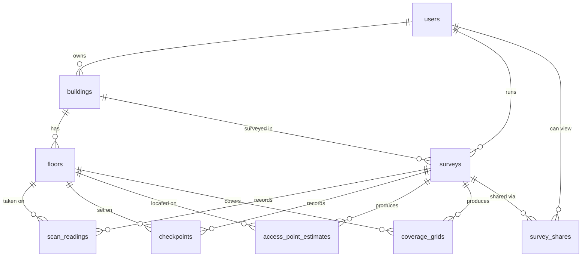

# SignalScape: Design (week 2)

Draft for review. Covers the database schema, the REST API, access control and the processing math. Requirement IDs (FR-x, C-x) refer to `REQUIREMENTS.md`.

## 1. Conventions

- **IDs:** UUID v4 for every table except `scan_readings` (bigint, for volume).
- **Times:** `timestamptz`, stored in UTC, sent as ISO 8601.
- **Positions:** WGS84 latitude/longitude (EPSG:4326) are the source of truth. The phone takes a GPS fix at survey start (accuracy 10 m or better, ideally at an entrance or window) as the survey origin, then adds dead-reckoning offsets in meters and converts them to lat/lng. No building outline or manual geo-anchoring is needed. For math, the API projects lat/lng to local meters around the survey origin (equirectangular, accurate to centimeters at building scale) and converts results back.
- **Deletes:** hard deletes with `ON DELETE CASCADE` from parent to child, so deleting an account or survey removes all its data (FR-20, RA 10173).
- **Timestamps:** every table has `created_at`; editable tables also have `updated_at`.

## 2. Database schema (PostgreSQL 16)



### users
| Column | Type | Notes |
|---|---|---|
| id | uuid PK | |
| email | text, unique (case-insensitive) | login |
| name | text | |
| password_hash | text | bcrypt (FR-3a) |
| role | enum `admin`, `surveyor`, `viewer` | default `surveyor` (FR-2) |
| is_active | boolean | default true; admins can deactivate |
| consented_at | timestamptz, null | set on the consent screen (FR-22); surveys need it |
| good_threshold_dbm | smallint | default -67 (FR-15) |
| dead_threshold_dbm | smallint | default -80; check `dead < good` |
| created_at, updated_at | timestamptz | |

### buildings
| Column | Type | Notes |
|---|---|---|
| id | uuid PK | |
| owner_id | uuid FK users, cascade | creator |
| name | text | unique per owner |
| address | text, null | |
| description | text, null | |
| created_at, updated_at | timestamptz | |

### floors
| Column | Type | Notes |
|---|---|---|
| id | uuid PK | |
| building_id | uuid FK buildings, cascade | |
| level | smallint | 0 = ground, negative = basement; unique per building |
| label | text | e.g. "2F" |
| width_m, length_m | numeric(6,2), null | optional approximate size (FR-5), used only to size the 3D floor plane |
| height_m | numeric(4,2) | default 3.0; used to stack floors in 3D |
| plan_image_path | text, null | uploaded floor plan, stored in a Docker volume |
| created_at, updated_at | timestamptz | |

### surveys
| Column | Type | Notes |
|---|---|---|
| id | uuid PK | |
| building_id | uuid FK buildings, cascade | |
| surveyor_id | uuid FK users, cascade | |
| status | enum `active`, `paused`, `completed`, `processed` | FR-6 |
| started_at | timestamptz | |
| ended_at | timestamptz, null | |
| device_model | text, null | for the paper's test notes |
| has_barometer | boolean | false means manual floor selection |
| origin_lat, origin_lng | double precision | GPS fix at survey start |
| origin_accuracy_m | real | reported GPS accuracy of that fix |
| step_length_m | numeric(3,2) | default 0.7 |
| notes | text, null | |
| processed_at | timestamptz, null | last processing run |
| created_at, updated_at | timestamptz | |

### scan_readings (FR-7 to FR-9, FR-12)
| Column | Type | Notes |
|---|---|---|
| id | bigint identity PK | |
| survey_id | uuid FK surveys, cascade | |
| floor_id | uuid FK floors, cascade | |
| client_id | uuid | generated on the phone; unique per survey, so offline re-uploads are idempotent (FR-11) |
| lat, lng | double precision | estimated position |
| accuracy_m | real, null | estimated position error |
| bssid | macaddr | |
| ssid | text | empty string for hidden networks |
| rssi_dbm | smallint | check -120 to 0 |
| frequency_mhz | integer | band derived: under 3000 = 2.4 GHz, else 5 GHz |
| scanned_at | timestamptz | |

Indexes: `(survey_id, floor_id)`, `(survey_id, bssid)`, unique `(survey_id, client_id)`.

### checkpoints (FR-10)
| Column | Type | Notes |
|---|---|---|
| id | uuid PK | |
| survey_id | uuid FK surveys, cascade | |
| floor_id | uuid FK floors, cascade | |
| client_id | uuid | unique per survey |
| lat, lng | double precision | true position (tapped by the surveyor or a good GPS fix) |
| estimated_lat, estimated_lng | double precision | dead-reckoning position at that moment, so drift is measurable |
| source | enum `tap`, `gps` | |
| recorded_at | timestamptz | |

### access_point_estimates (FR-14)
| Column | Type | Notes |
|---|---|---|
| id | uuid PK | |
| survey_id | uuid FK surveys, cascade | |
| floor_id | uuid FK floors, cascade | floor with the strongest readings |
| bssid | macaddr | unique per survey |
| ssid | text | |
| frequency_mhz | integer | |
| lat, lng | double precision | estimated position |
| method | text | e.g. `weighted_centroid` |
| reading_count | integer | |
| max_rssi_dbm | smallint | |
| computed_at | timestamptz | |

### coverage_grids (FR-13, FR-15, FR-19)
| Column | Type | Notes |
|---|---|---|
| id | uuid PK | |
| survey_id | uuid FK surveys, cascade | |
| floor_id | uuid FK floors, cascade | |
| bssid | macaddr, null | null = strongest signal of any network |
| method | text | e.g. `idw` |
| cell_size_m | real | default 1.0 |
| origin_lat, origin_lng | double precision | south-west corner of the grid |
| cols, rows | smallint | |
| values | jsonb | row-major array of dBm, `null` where there's no data |
| good_pct, fair_pct, dead_pct | real | share of covered cells per level |
| good_threshold_dbm, dead_threshold_dbm | smallint | thresholds the percentages and cell levels were computed with (the surveyor's at processing time) |
| raw_reading_count, cleaned_reading_count | integer | readings stored vs. kept after cleaning, for the summary |
| computed_at | timestamptz | |

Unique `(survey_id, floor_id, bssid) NULLS NOT DISTINCT`. Grids are cached results and are rebuilt by `POST /process`.

### survey_shares (Viewer role, FR-2)
| Column | Type | Notes |
|---|---|---|
| survey_id | uuid FK surveys, cascade | PK part |
| user_id | uuid FK users, cascade | PK part; the viewer |
| created_at | timestamptz | |

## 3. Access control (FR-3)

Enforced in the API through a dependency on every route, not in the app.

| Action | Admin | Surveyor | Viewer |
|---|---|---|---|
| Manage users | all | no | no |
| Buildings and floors | all | own | no |
| Create a survey, upload readings | yes | own buildings, after consent | no |
| Read survey, coverage, export | all | own | shared with them |
| Delete a survey | all | own | no |
| Own profile, settings, delete account | yes | yes | yes |

"Own" means `buildings.owner_id` or `surveys.surveyor_id` matches the token's user. Requests for something the user can't see return **404**, not 403, so IDs can't be probed.

## 4. REST API

Base path `/api`. JSON in and out. Auth is `Authorization: Bearer <JWT>` (HS256, 24-hour expiry, claims `sub` = user ID and `role`). OpenAPI is generated by FastAPI at `/api/docs` (C-10).

**List endpoints** (FR-3b) all take `page` (default 1), `page_size` (default 20, max 100), `sort` (field name, prefix `-` for descending) plus the filters below, and return:

```json
{ "items": [], "total": 0, "page": 1, "page_size": 20 }
```

**Errors:** `401` no or bad token, `404` not found or not visible, `409` conflict (duplicate email, floor level), `422` validation error with FastAPI's `detail` list.

### Auth and profile
| Method | Path | Role | Purpose |
|---|---|---|---|
| POST | `/auth/register` | public | create a Surveyor account |
| POST | `/auth/login` | public | email and password, returns `access_token` |
| GET | `/auth/me` | any | profile and thresholds |
| PATCH | `/auth/me` | any | name, password, thresholds |
| POST | `/auth/me/consent` | any | record privacy consent (FR-22) |
| DELETE | `/auth/me` | any | delete account and all data (FR-20) |

### Users (admin)
| Method | Path | Filters and sort |
|---|---|---|
| GET | `/users` | `role`, `is_active`, `q` (name or email); sort `created_at`, `name`, `email` |
| GET / PATCH / DELETE | `/users/{id}` | PATCH sets `role`, `is_active` |

### Buildings and floors (FR-4, FR-5)
| Method | Path | Notes |
|---|---|---|
| GET | `/buildings` | filters `q`, `owner_id` (admin); sort `name`, `created_at` |
| POST | `/buildings` | |
| GET / PATCH / DELETE | `/buildings/{id}` | GET includes its floors |
| GET | `/buildings/{id}/floors` | sort `level` |
| POST | `/buildings/{id}/floors` | |
| PATCH / DELETE | `/floors/{id}` | |
| PUT | `/floors/{id}/plan` | multipart image upload, PNG or JPEG, max 5 MB |
| GET | `/floors/{id}/plan` | returns the image |

### Surveys (FR-6 to FR-12)
| Method | Path | Notes |
|---|---|---|
| GET | `/surveys` | filters `building_id`, `status`, `surveyor_id` (admin), `from`, `to`; sort `started_at`, `status` |
| POST | `/surveys` | `building_id`, device info; needs consent |
| GET / PATCH / DELETE | `/surveys/{id}` | PATCH changes `status` (active, paused, completed) and notes |
| POST | `/surveys/{id}/readings` | batch of up to 1,000 readings; duplicates by `client_id` are skipped; returns counts inserted and skipped |
| GET | `/surveys/{id}/readings` | filters `floor_id`, `bssid`, `min_rssi`; sort `scanned_at`, `rssi_dbm` |
| POST | `/surveys/{id}/checkpoints` | batch, idempotent by `client_id` |
| GET | `/surveys/{id}/checkpoints` | filter `floor_id` |
| GET | `/surveys/{id}/networks` | distinct SSID/BSSID pairs with reading counts (for the FR-17 filter) |
| POST | `/surveys/{id}/shares` | `{ "email": "..." }` of a Viewer |
| DELETE | `/surveys/{id}/shares/{user_id}` | |

### Processing and results (FR-13 to FR-21)
| Method | Path | Notes |
|---|---|---|
| POST | `/surveys/{id}/process` | `preview=true` runs on synced data without changing status; otherwise builds coverage grids (strongest signal plus each BSSID) and access point estimates; runs synchronously (NFR-1, under 30 s per floor); sets status `processed` |
| GET | `/surveys/{id}/coverage` | `floor_id` (required), `bssid` (optional); returns the grid plus the thresholds used |
| GET | `/surveys/{id}/access-points` | filter `floor_id`, `ssid` |
| GET | `/surveys/{id}/summary` | per floor: area covered, readings, floor height, good/fair/dead percentages (FR-19) |
| GET | `/surveys/{id}/export.csv` | all readings as CSV (FR-21) |
| GET | `/surveys/{id}/geojson` | GeoJSON FeatureCollection; params `floor_level`, `bssid`, `include` (`cells`, `access_points`, `readings`) |

**GeoJSON output:** coverage cells are `Polygon` features (properties `rssi_dbm`, `level` good/fair/dead, `floor_level`, `bssid`); access points and readings are `Point` features (`ssid`, `bssid`, `floor_level`, `rssi_dbm`). Map clients (Leaflet or MapLibre) show one layer per `floor_level`. Three.js uses the same data, projected back to local meters around the survey origin, with height `floor_level × floor height`.

## 5. Processing math

**Data cleaning (first step of processing):** drop readings outside -100 to -20 dBm or with a bad BSSID; merge repeat scans of the same BSSID within 1 m and 10 s into one reading using the median RSSI; drop outliers more than 2.5 MAD (median absolute deviation) from their 3 m neighborhood median. Cleaned counts are reported in the summary.

**Coverage (FR-13):** inverse distance weighting per floor. For each grid cell, average the readings within a 10 m radius, weighted by `1 / d²`; cells with no reading in range stay `null`. For the strongest-signal grid, take each position's maximum RSSI across networks first. RSSI is averaged in dBm, which is fine for a coverage view. IDW is simple, fast enough for NFR-1, and easy to test; kriging can be compared in the paper.

**Levels (FR-15):** a cell is good at or above the user's `good_threshold_dbm` (-67), dead below `dead_threshold_dbm` (-80), and fair in between.

**Access points (FR-14):** weighted centroid of the strongest 10 readings for each BSSID, with linear-power weights `10^(rssi / 10)`, placed on the floor where its readings are strongest. A log-distance path-loss fit can replace it later without changing the API, since `method` is stored.

**Drift correction (FR-10):** done on the phone. Between two checkpoints (a tapped position or a GPS fix with accuracy 10 m or better), the app spreads the position error linearly over the readings taken in between before uploading, so the API stores corrected positions. Indoor GPS is often 5 to 30 m off, so only good fixes are used.

## 6. Client app behavior

**Offline-first sync (FR-11, FR-12):**
1. Every reading and checkpoint is written to a local sqflite database first, with a phone-generated `client_id` and `synced = false`.
2. A background sync worker posts unsynced rows in batches of up to 500 and marks them synced when the API confirms.
3. On failure it retries with growing waits (5 s, 10 s, 30 s, capped at 2 min) and also retries as soon as connectivity returns.
4. Duplicate `client_id`s are skipped server-side, so a batch that arrived but lost its reply is safe to resend.
5. The survey screen shows the reading count, how many are waiting to sync, and an online/offline indicator. Ending a survey flushes the queue; if still offline the survey stays "ending" locally and is completed and processed once synced.

**Live visuals during a survey:**
- A trail of points on the floor plan, each colored by RSSI against the user's thresholds (good, fair, dead). Works offline.
- When online, a preview heatmap refreshed about every 60 s by calling `POST /surveys/{id}/process?preview=true` on the readings synced so far. Preview results are not marked final and the status stays `active`.

## 7. Open decisions

1. **IDW vs kriging:** this draft uses IDW for the API and leaves kriging as a comparison for the paper.
2. **Floor dimensions (decided):** `floors.width_m` and `length_m` are optional, used only to size the 3D floor plane; the grid extent comes from the readings.
3. **3D view location (decided):** a Three.js page served by the API at `/api/viewer/` and opened in the app's WebView keeps one implementation. The page is static and public (it holds no data). The app hands it the survey ID and the user's JWT in the URL fragment (`/api/viewer/#survey=<id>&token=<jwt>`) or by calling `window.signalscapeViewer.start({surveyId, token})` after load. A fragment is never sent to a server, so the token stays out of access logs and Caddy logs. The page removes it from the address bar and keeps it in memory only, then calls `/surveys/{id}`, `/summary`, `/networks`, `/access-points` and `/coverage` with `Authorization: Bearer`, so roles and shares apply as for any client. Floor heights come from `floor_height_m` in `/summary`, because Viewers cannot read `/buildings`. The page is served with a strict Content-Security-Policy (own scripts and styles only, `connect-src 'self'`, no framing). Three.js is vendored under `api/app/static/viewer/vendor/` (no CDN, no build step).
4. **Refresh tokens:** left out for now (24-hour access tokens). Can be added if the app needs longer sessions.
5. **Viewer role:** included through `survey_shares`; can be dropped if two roles are enough.
