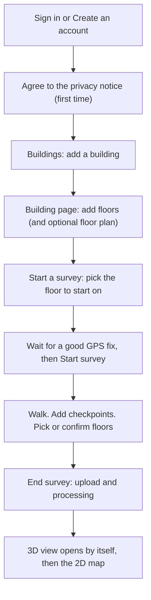

# Surveyor guide: mapping a building's Wi-Fi with the app

For people who walk a building with the SignalScape Android app. It follows the screens as they exist in the app today, using the same words you see on screen. Technical background is in [DESIGN.md](DESIGN.md); the API behind the app is in [API_GUIDE.md](API_GUIDE.md).

## What you need

- An Android phone (Android 7.0 or newer) with the SignalScape app installed. The app is not on a store yet: the test APK comes from the CI build artifact `app-release-apk` (see [CI_CD.md](CI_CD.md)). Wi-Fi scanning does not work in an emulator.
- Internet at least some of the time. The app also works offline and uploads later.
- Location switched on in the phone settings. The app asks for Location, Nearby Wi-Fi devices and Physical activity (step counting). Location is required by Android for Wi-Fi scans.
- A building and floors to survey. You create them in the app.

## The steps at a glance

## 1. Sign in or create an account

Open the app. The first screen says **SIGNALSCAPE**, "Map your building's Wi-Fi, floor by floor".

- **Sign in:** type your Email and Password (the eye icon shows or hides the password) and tap **Sign in**. A wrong combination shows "Wrong email or password."
- **New here? Tap Create an account.** The **Create account** screen (titled "NEW SURVEYOR") asks for Name, Email, Password (at least 8 characters) and Confirm password. Tap **Create account**. If the email is already used, it says "That email already has an account. Go back and sign in." and **I already have an account** takes you back. After creating the account you are signed in.
- New accounts are Surveyors. An administrator can change roles (see [API_GUIDE.md](API_GUIDE.md)).
- To leave, tap **Sign out** at the top right of the **Buildings** screen.

## 2. Privacy notice (first time)

Before your first survey the app shows **Before your first survey** with the **Privacy notice · RA 10173**. It explains why the app asks for data, what it collects (your name, email and hashed password; GPS only while a survey runs, a start fix; Wi-Fi names, signal strengths and the walk), who can see it (you and the server's administrators), how it is protected, and your rights. Read it, tick "I have read the privacy notice and I agree to the use of my data as described.", and tap **Agree and continue**. **Not now** signs you out, and no survey can start until you agree. You are asked only once.

## 3. Buildings

The **Buildings** screen lists your buildings. You can:

- search ("Search buildings"), sort (Name A–Z, Name Z–A, Newest first, Oldest first) and page through with **Load more**;
- add one with **Add building** (name required, address and description optional);
- open one to see its floors. **Edit building** (pencil icon) changes the details.

An empty list says "No buildings yet. Add the first one to start surveying." (Viewer accounts see "No buildings here. Viewers see surveys that are shared with them, not the building list.")

## 4. Floors and floor plans

On the building page tap **Add floor**:

- **Label**, for example "Ground" or "2nd floor".
- **Level**, where 0 is ground and basements are negative.
- **Floor height (m)**, floor to floor, usually 3 to 3.5 m. The barometer uses it to detect floor changes (3.3 m is assumed if a floor has none).
- **Width (m)** and **Length (m)**, optional, only used to size the floor in the 3D view.
- **Choose floor plan**, optional: a PNG or JPEG picture of the floor, up to 5 MB. It is stored with the floor and shown as a small thumbnail.

Add a floor for every floor you will walk, before you start. Two floors cannot have the same level in one building.

## 5. Starting a survey

On the building page, under **Start a survey**, choose the **Floor to start on** and tap **Continue to survey**.

The app asks for the permissions listed above. If Location permission is refused it says "Location permission is needed to scan Wi-Fi and get a GPS fix."; if Location is off in the phone settings it says "Turn on Location in the phone settings, then come back."

The survey screen opens with the title "Survey · <floor>". The status card shows:

- **WAITING FOR GPS**: the phone is looking for a position.
- **GPS TOO WEAK**: the fix is worse than 10 m. The button stays disabled and the app says "Wait for a GPS fix of 10.0 m or better."
- **READY TO SCAN**: the fix is good enough.

Stand where you want the map to start. Near a window or doorway the GPS fix is usually good enough. Then tap **Start survey**. This GPS position becomes the starting point of the survey; from then on the phone estimates your position from your steps and compass heading (dead reckoning).

The top right shows **ONLINE** or **OFFLINE**.

## 6. Walking and scanning

The status changes to **SCANNING**. Walk at a normal pace with the phone held steadily, and the app does the rest.

- It scans Wi-Fi about every 2 steps, or at least every 30 seconds, when Android allows it. Android allows only about 4 scans per 2 minutes, so the card shows "Scans n/4 per 2 min" and when the next one is ready. If Android blocks a scan the app says "Android is limiting Wi-Fi scans; waiting a bit." (see the tips below).
- The counters **READINGS** and **STEPS** go up. A coloured dot appears on the **trail** for each scan, coloured by signal. A line follows every step you walk.
- The box in the corner shows the latest signal, for example "-58 dBm · FAIR".
- The legend uses your thresholds: **Good** at or above -67 dBm, **Fair** between -67 and -80 dBm, **Dead** below -80 dBm (your own thresholds if you changed them).
- The line **Sync** shows "all saved to the server" or how many readings are waiting. Readings are saved on the phone first and uploaded in batches, so a bad connection does not lose data. Offline work uploads when the phone is back online.
- **Pause** stops scanning (for a break) and **Resume** continues.

## 7. Checkpoints: fixing drift

Step counting drifts over time. Tap **Add checkpoint (fix drift)** now and then:

- If the phone has a good GPS fix at that moment (10 m or better, taken in the last 10 seconds), the app pulls your position to the GPS position and corrects the readings since the last checkpoint. It says for example "Checkpoint saved. GPS ±6 m. Position was 4.2 m off; 31 readings corrected."
- With no good fix, it says "Checkpoint saved. No good GPS fix, so the position was kept and no drift was corrected."

Good places for a checkpoint are next to windows, doors and stairwell openings. Readings wait on the phone (up to 4 minutes) for the next checkpoint to be corrected before they upload, so checkpoint at least every few minutes.

## 8. Changing floors (barometer)

The **FLOOR** box on the survey screen shows the floor you are on. Change it by hand at any time with the dropdown; your choice always wins.

If the phone has a barometer, the line says "Barometer on: floor changes are detected from air pressure." When it notices you moved up or down a floor (about a quarter floor more clearly, then about 3 seconds on the new floor) it says "Looks like you are on <floor>." with **Switch** or **Ignore**. Turn on **Auto-switch** to let it switch without asking ("Switched to <floor> (barometer)."). If the phone has no barometer it says "No barometer on this phone. Pick the floor by hand above." Make sure the new floor exists in the building (add floors before you start).

Take a checkpoint when you arrive on a new floor if you can.

## 9. Live preview

About once a minute, while the phone is online, the app asks the server for a quick heatmap of what you have collected and draws it under your trail as a smooth colour field (red strong, through yellow and green, to blue weak, the same colours as the maps) ("Heatmap preview · updated 14:32"). Offline it keeps the last one ("Heatmap preview: offline, showing the last one"). Until the first one arrives it says "Heatmap preview appears here about every minute while online." The preview is a guide to where signal is missing; the final map is made when you end the survey.

## 10. Ending the survey

Tap **End survey**. The app releases held readings, uploads everything left ("Uploading n readings, then processing…"), marks the survey completed, and the server builds the coverage maps and estimates the access points. When it finishes, the app opens the **3D view** of your survey by itself (section 11), and from there the **2D map** (section 12).

**Look at the results before you leave those screens.** The app does not have a survey history screen yet, so once you go back to **Buildings** there is no button to reopen that survey's maps.

If the upload cannot finish (for example no connection), you see "Upload not finished: …" and the status **NOT FINISHED**. Your data is still saved on the phone. Tap **Try finishing again** when you are online.

If you close the app or the phone dies mid-survey, the next time you open the **Buildings** screen it asks "Unfinished survey" with **Resume**, **End survey** or **Later**. **Resume** returns you to the survey paused: stand where you are on the map, add a checkpoint to re-sync your position, then press **Resume**. **End survey** uploads and processes what was collected; when it is done the **Buildings** screen says "Survey finished and processed." with a **View 3D** button (tap it right away, it is the only way back in).

Pressing back during a survey asks "Leave this survey?" ("Readings already taken stay on this phone and keep uploading…"). **Keep surveying** stays; **Leave** goes back.

## 11. The 3D view

**Coverage in 3D** shows your floors stacked, each with a smooth heatmap, estimated access points and your walk.

- **Reading the colours:** the heatmap is one continuous colour field. **Red** is a very strong signal (about -30 dBm), then orange, yellow, green, cyan and **dark blue** for a very weak one (-100 dBm). The **Legend** button in the top bar (it shows a small colour bar) opens the legend under it: a gradient bar with dBm ticks (-30, -45, -60, -75, -90, -100), with "Strong" on the left and "Weak" on the right, and under it your thresholds in words ("Good: -67 dBm or stronger", "Dead zone: weaker than -80 dBm").
- **Thin black contour lines** run along places with the same signal, one line every 5 dBm. Many lines close together mean the signal changes quickly; red blocks still mark dead zones.
- **Faded** colour means few readings were close by, so treat it as a guess. Places with no reading within 5 m have no colour, and the edge of the coloured area fades out softly.
- One finger rotates, two fingers pinch to zoom and slide to move.
- Tap a spot on a floor to see the signal of the nearest measured cell and its level, for example "Ground: -52.9 dBm · Good". The colour is smooth, but this number is a real cell value.
- **Legend:** on a phone it starts closed so it does not cover the view; tap **Legend** to open it and tap it again to close it. The page remembers your choice until you close the view. On a wide screen it starts open.
- **Layers** opens a panel (a sheet at the bottom of a phone, a side panel on a wide screen; **Close** or the Layers button closes it). It has **Network** (all networks, strongest signal, or one network), **Floors** (show or hide each floor), **Heatmap** and **Markers**, each in its own box. The message you get when you tap a spot (for example "Ground: -52.9 dBm · Good") appears in a bar at the very bottom, above the panel, so nothing sits on top of anything else.
  - **Heatmap:** the **Opacity** slider (10% to 100%) makes the colours more or less see-through. The **Min RSSI** slider hides everything weaker than the value you pick, from -100 to -30 dBm, which is a quick way to see only where the signal is good enough; its value shows next to it, for example "-75 dBm". **Contour lines** turns the black lines on or off.
  - **Markers:** Estimated access points, Walked path, start and end (green Start, red End), and Highlight dead zones.
- The **2D map | 3D** switch at the top right of the app bar goes to the map.

## 12. The 2D satellite map

**Coverage** (2D map) draws the same results on a satellite map with street labels (Mapbox, when the app build has a token; otherwise a street map from OpenStreetMap).

The controls are in two boxes so they stay out of each other's way:

- **Top box:** the floor chips (one floor at a time), the **Network** dropdown ("All networks (strongest signal)" or a single network, listed with its name, address (BSSID) and how many readings it has; the cells and access points reload for that network, which works on surveys that have been fully processed, and if nothing was heard on that floor it says "No readings of this network on this floor."), and two buttons beside it: **Display** (the sliders icon) and **Map style** (the layers icon).
- **Bottom box:** the **Coverage**, **Access points** and **Walk** chips turn each layer on or off. The walk shows **S** (start) and **E** (end) markers. Above it, at the left, is the **Legend**.
- **Display** opens a sheet with **Opacity** (10% to 100%), **Min RSSI** (hides everything weaker than the value, -100 to -30 dBm; the map redraws when you let go of the slider) and a **Contour lines** switch.
- **Map style** lets you pick **Satellite** (the default), **Streets light** or **Streets dark**. A tick shows the one in use, and the app remembers it until you close it. Without a Mapbox token in the app build there is only the OpenStreetMap street map, so the three choices are greyed out and the sheet says "Styles need a Mapbox token."
- The coverage is the same smooth colour field as in 3D, laid over the map, with thin black contour lines every 5 dBm.
- The **Legend** is a small chip with a colour bar; on a phone it starts closed. Tap it to open the colour bar with dBm ticks, then your thresholds ("Good ≥ -67 dBm", "Dead < -80 dBm") and "Faded = few readings". Tap it again to close it.
- Tap anywhere on the coverage to see the value of the nearest measured cell, for example "-62 dBm · Good · nearest cell", or "No data here (no reading within 5 m)".
- Tap an access point to see its name, BSSID and strongest reading.
- The **2D map | 3D** switch at the top right goes to the 3D view.
- If the survey has not been processed yet the screen says "Not processed yet", and a Surveyor sees **Process now**.

## 13. Tips for better maps

- **Turn off Wi-Fi scan throttling.** Android normally allows about 4 scans every 2 minutes, which gives few readings. On the phone: Settings, Developer options, switch off "Wi-Fi scan throttling" (enable Developer options first by tapping Build number 7 times in About phone). You get a scan every few steps and a much denser map. If the app shows the "Android is limiting Wi-Fi scans" message, this is the fix.
- **Walk slowly** and steadily, and cover corridors and rooms along their length, because only places you walked get a colour.
- **Checkpoint every few minutes**, and at windows, doors and when you change floors, so drift stays small. Readings wait up to 4 minutes for a checkpoint before they are uploaded uncorrected.
- **Start at an entrance or window** so the starting GPS fix is good (10 m or better).
- **Add floors first**, with correct heights, so the barometer can detect floor changes.
- Keep the phone **charged and the app open on screen** during the survey. One survey can span several floors; switch floors as you move.

## What the app does not have yet

These parts of the milestone plan ([IMPLEMENTATION.md](../IMPLEMENTATION.md)) are not built, so you will not find them in the app: a survey history list, a survey summary screen with CSV export (the CSV export exists in the API), profile and settings with delete account, an admin user screen, and deleting buildings or floors from the app. Tapping a position on the floor plan as a checkpoint is also not built; checkpoints use the GPS fix.

## Not verified

- The text in this guide was taken from the app's source code, not from screenshots of a phone. Small wording differences are possible.
- The tip about the number of taps to enable Developer options varies by phone maker.
- "Android 7.0 or newer" comes from the app's `minSdk` setting (24), which was not tested on old phones.
